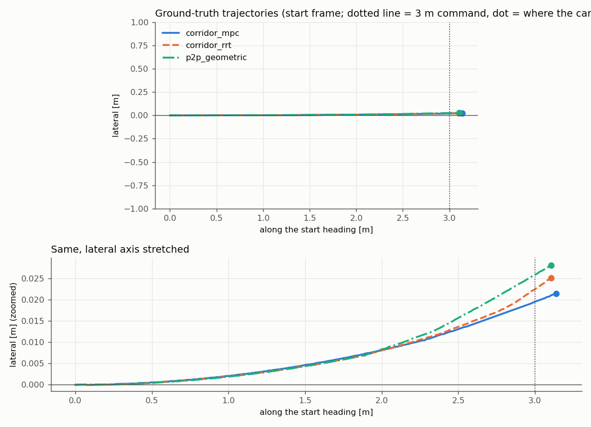
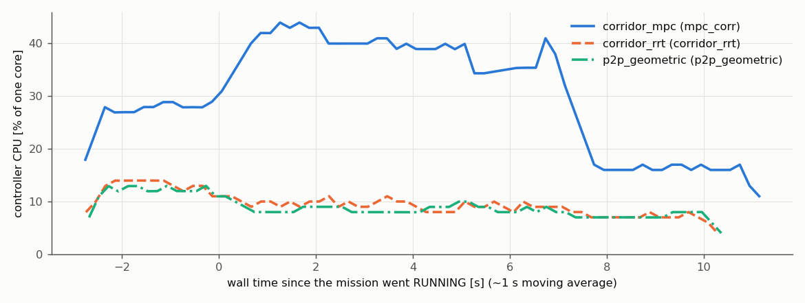
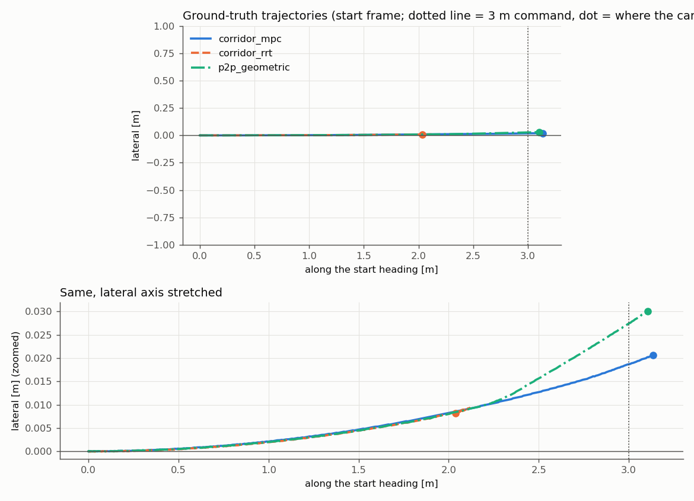
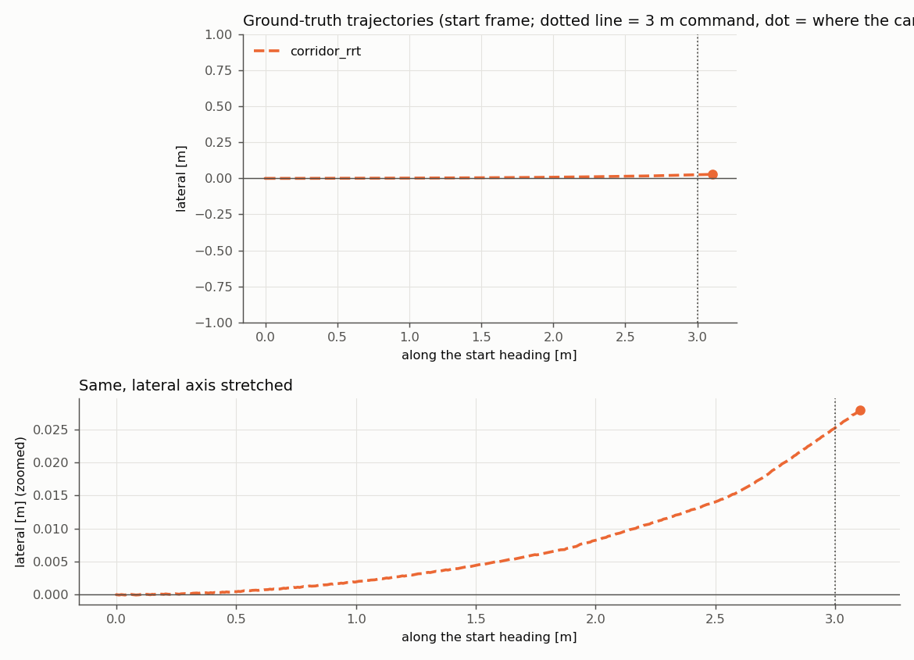
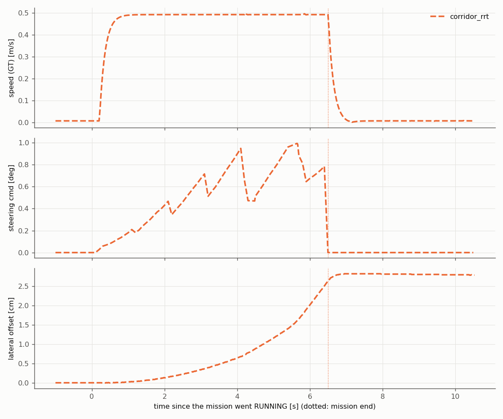
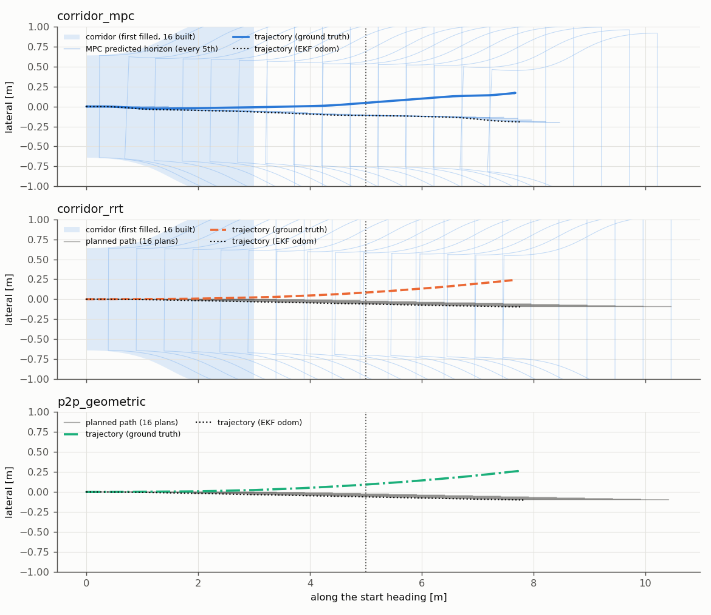

# corridor_mpc, corridor_rrt e p2p_geometric a confronto

Questo `report.md` e' stato scritto in migrazione (2026-11-19, recupero dalla macchina **work**):
le 11 sessioni avevano ognuna il proprio `report.md` generato dall'harness e nessun testo di sintesi.
I report per sessione sono in [`sessions/`](sessions/), verbatim, con i soli link alle figure riscritti.

## Setup

Macchina **work** (`DESKTOP-Q3F81S6`, Windows 10 + WSL Ubuntu 24.04, RTX 4090): Isaac Sim 5.1.0 sul
lato Windows, lo stack ROS 2 Jazzy nella WSL. Branch `planner-modes-hil`, commit `22a960e8` per 8
sessioni e `e326bb42` per le 3 sulla porta.

Il modo si seleziona con `planner_controller_mode` (`corridor_mpc` | `corridor_rrt` | `p2p_geometric`,
introdotto in `266eebae`). Harness: `scripts/sim/planner_compare/` (`run.sh`, `pc_record.py`,
`pc_analyze.py`), che per ogni modo riavvia lo stack, manda **lo stesso comando in linguaggio
naturale** al planner LLM e registra `/drive`, odom, ground truth e la CPU del processo controller da
`/proc`. I PDF per sessione li assembla `pc_pdf.py`, che non era nel repo (recuperato nel tar).

Tre scene: `base_room` layout `campaign` (muro frontale a 4.61 m misurato dal lidar), `corridor`
layout `matte`, `office` layout `door_left`.

## Metodo

Per sessione: un run per modo, stessa missione. L'harness verifica che l'LLM abbia prodotto la stessa
missione per i tre modi (`moves sha`) e lo dichiara in testa al report quando non e' cosi'.

## Risultati

### Scena `corridor`: i tre modi sono equivalenti, la CPU no

Due sessioni (`corridor_20261113_141648`, `final_20261113_143722`), comando "go straight 3m",
missione identica (`moves sha 86892f5ef777`). Tutti e tre COMPLETE.

| | corridor_mpc | corridor_rrt | p2p_geometric |
|---|---|---|---|
| esito (2 sessioni) | COMPLETE, COMPLETE | COMPLETE, COMPLETE | COMPLETE, COMPLETE |
| fermata (m, su 3 comandati) | 3.140 / 3.138 | 3.105 / 3.105 | 3.105 / 3.105 |
| durata (s) | 6.72 / 6.77 | 6.50 / 6.50 | 6.43 / 6.42 |
| CPU controller (% core) | 40.3 / 37.8 | 8.7 / 9.2 | 8.5 / 8.4 |
| CPU per secondo simulato (ms) | 405.2 / 400.0 | 87.3 / 90.5 | 84.8 / 83.9 |
| plan time medio (ms) | — | 1.03 / 1.01 | 0.34 / 0.34 |
| variazione totale sterzo (deg) | 6.2 / 5.8 | 4.4 / 4.2 | 4.2 / 4.5 |

`corridor_mpc` costa **4-5 volte** la CPU degli altri due per lo stesso risultato. Il suo
`solve_dt_sec` resta 0 in tutte le sessioni (clock ROS in tempo simulato): per il costo dell'MPC
vanno usate le colonne di CPU di processo, non quelle del solver.

### Scena `base_room`: corridor_rrt si ferma a 2.04 m

Due sessioni (`20261113_132510`, `20261113_140122`), stesso comando, stessa missione.

| | corridor_mpc | corridor_rrt | p2p_geometric |
|---|---|---|---|
| esito | ABORTED, COMPLETE | **ABORTED, ABORTED** | COMPLETE, COMPLETE |
| fermata (m) | -0.100 / 3.135 | **2.037 / 2.038** | 3.105 / 3.105 |
| durata (s) | 23.22 / 6.72 | 23.22 / 23.12 | 6.45 / 6.48 |
| CPU controller (% core) | 49.9 / 44.3 | 71.7 / 71.2 | 10.6 / 10.1 |

Il guasto e' riproducibile al millimetro su due run (2.037 e 2.038 m) ed e' la ragione per cui la CPU
di `corridor_rrt` sale a 71 % core: il target di un move DRIVE e' un punto che rotola
`rrt_corridor_length_drive_m` = 3.0 m davanti all'auto, quindi dopo circa 1.8 m finisce **dentro** il
muro frontale a 4.61 m. RRT\* non trova piu' un piano, `plan()` torna `None`, l'auto tiene zero e
`_needs_replan` ripone la stessa domanda impossibile a ogni tick, bruciando tutto
`rrt_time_budget_s`: 188 fallimenti consecutivi, poi timeout ABORTED.

### La correzione: `rrt_target_retreat`

Sessione `retreat_on_142913`, stessa scena e stesso comando, con il flag attivo (codice non ancora
committato al momento del run; e' diventato `3af7d70c`). `retreat_goal()` cammina la centerline del
corridoio dall'estremo lontano indietro fino al primo punto libero, un solo retry, mai ricorsivo.

| | corridor_rrt senza retreat | corridor_rrt con retreat |
|---|---|---|
| esito | ABORTED | **COMPLETE** |
| fermata (m) | 2.038 | **3.105** |
| durata (s) | 23.12 | 6.50 |
| CPU controller (% core) | 71.2 | 12.5 |
| plan time medio / p95 / max (ms) | 1.06 / 1.31 / 1.37 | **12.68 / 57.80 / 81.97** |

Un piano fallito fa girare RRT\* due volte, quindi il caso peggiore per tick e' `2 * rrt_time_budget_s`:
e' questo che si vede nel plan time. Controprova `rrt_test_1m5_141256`, stesso scenario ma comando
"go straight 1.5m" (target sempre entro il muro): COMPLETE a 1.619 m con plan time medio 1.12 ms, il
retreat non scatta. Nelle due sessioni `corridor` il retreat non scatta mai (7 piani, 7 risolti): il
percorso di default non cambia.

### Scena `office`, porta a sinistra: falliscono tutti e tre allo stesso modo

Tre ripetizioni (`door_20261113_150023`, `door_sem_20261113_151220`, `door_sem2_20261113_152122`),
comando "go straight 5m then enter the door on the left", missione identica (`moves sha fa9e6540f521`).
**Nove run su nove ABORTED**, tutti fra 7.663 e 7.717 m, con 16 reference pubblicate per modo.

| | corridor_mpc | corridor_rrt | p2p_geometric |
|---|---|---|---|
| esito (3 ripetizioni) | ABORTED ×3 | ABORTED ×3 | ABORTED ×3 |
| fermata (m) | 7.666 / 7.673 / 7.717 | 7.664 / 7.663 / 7.713 | 7.712 / 7.713 / 7.667 |
| offset laterale max (m) | 0.170 / 0.117 / 0.116 | 0.242 / 0.261 / 0.241 | 0.261 / 0.263 / 0.243 |
| CPU controller (% core) | 38.6 / 39.6 / 42.2 | 8.8 / 10.0 / 8.7 | 10.7 / 9.8 / 10.6 |

Lo stesso punto d'arresto sui tre modi e sulle tre ripetizioni dice che il limite non e' nel
planner-controller.

### Due sessioni che non misurano niente

`20261113_130155`: i tre run restano IDLE, nessuno stato RUNNING e nessuna ground truth registrata, e
le missioni LLM differiscono fra i modi. `20261113_131424`: tutti e tre ABORTED senza muoversi
(-0.100 m, 0.101 m percorsi). Conservate per completezza, nessun dato utilizzabile.

## Conclusioni

- Sulla stessa missione, in una scena senza ostacoli, i tre modi arrivano allo stesso risultato.
  `corridor_rrt` e `p2p_geometric` lo fanno con un quarto della CPU di `corridor_mpc`.
- `corridor_rrt` aveva un guasto deterministico: il target rotolante di un move DRIVE entra in
  qualunque muro piu' vicino di `rrt_corridor_length_drive_m`. `rrt_target_retreat` lo risolve e resta
  spento per default, perche' per un target terminale rifiutare di pianificare dentro un muro e' il
  comportamento giusto.
- Il costo del retreat e' nel plan time, non nella CPU totale: 12.68 ms medi contro 1.09, con p95 57.8
  e max 81.97 ms, cioe' il doppio budget quando il primo tentativo fallisce.
- L'ingresso porta non e' un problema di planner.
- Niente di tutto questo e' stato provato sull'auto: solo HIL in Isaac sulla work.

## Prossimi passi

- Capire l'arresto a 7.67 m in `office`/`door_left` nel behaviour `enter_door` (fuori da quest'area).
- Decidere se `corridor_rrt` con il retreat attivo puo' sostituire `corridor_mpc` come default: manca
  una prova con ostacoli e una sull'auto.
- `pc_pdf.py` e `rrt_analyse.py` sono rimasti fuori dal repo: se l'harness resta in uso vanno dentro
  `scripts/sim/planner_compare/`.
