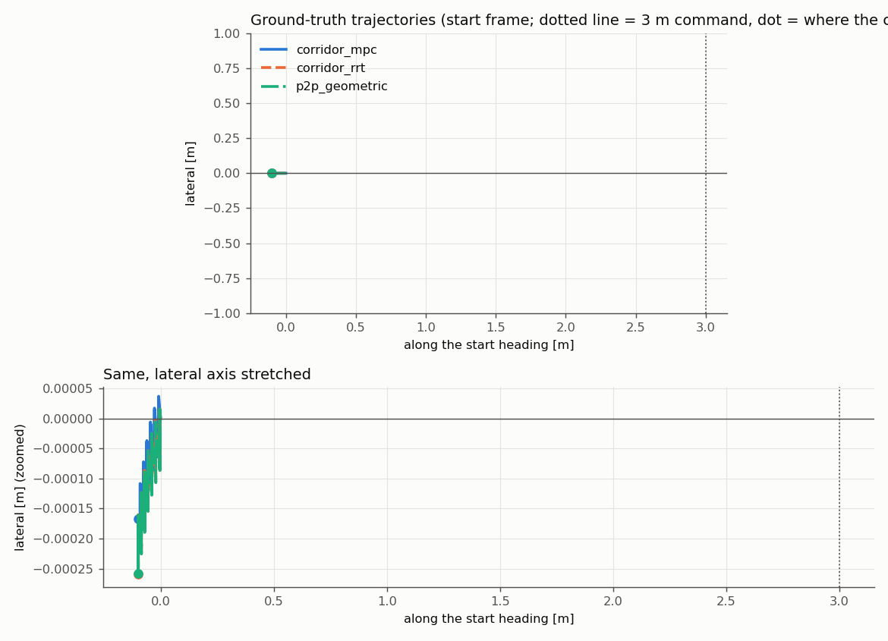
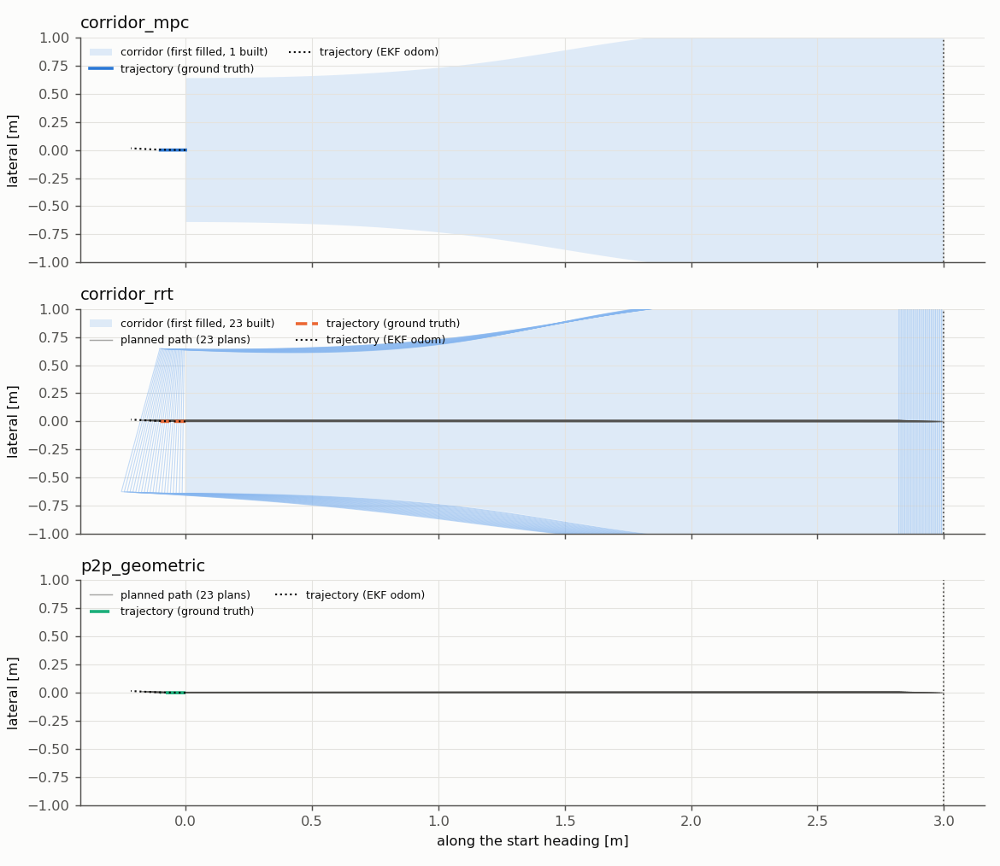
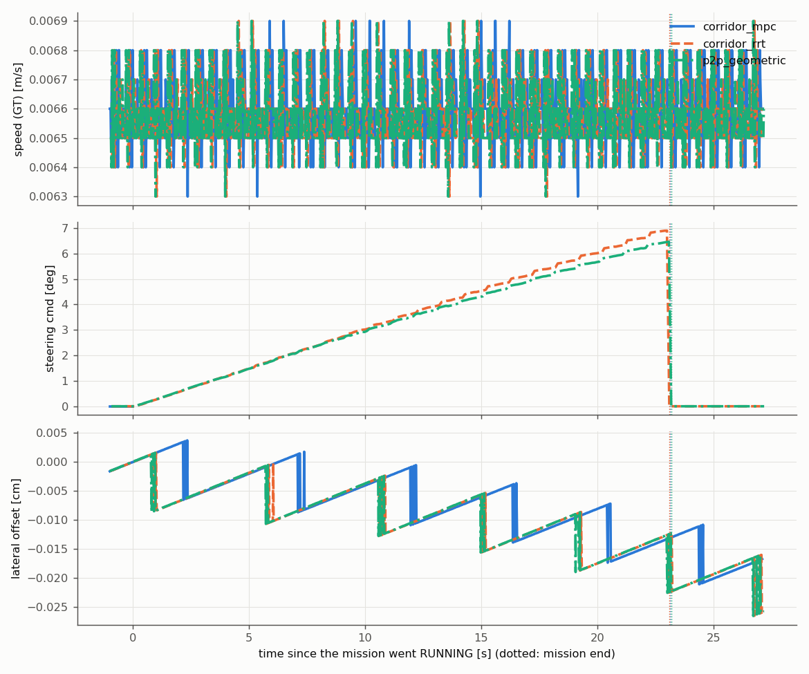
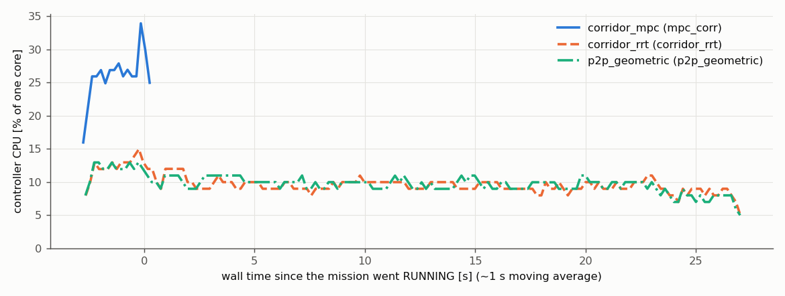

# Planner-controller comparison: "go straight 3m"

Session `20261113_131424`, host `DESKTOP-Q3F81S6`, scene `base_room` layout `campaign`, branch `planner-modes-hil` @ `22a960e`. One run per mode, the same command sent through the LLM planner each time.

The LLM produced the **same mission** for every mode (moves sha `86892f5ef777`):

```json
[
 {
  "id": "move_0_straight",
  "drive": {
   "mode": "straight",
   "speed": 0.5
  },
  "stop_condition": {
   "type": "distance_reached",
   "distance": 3.0
  },
  "timeout_sec": 23,
  "on_timeout": "abort",
  "terminal": true
 }
]
```

## Results

| metric | unit | corridor_mpc | corridor_rrt | p2p_geometric |
|---|---|---|---|---|
| mission result |  | ABORTED | ABORTED | ABORTED |
| mission duration | s | 23.12 | 23.1 | 23.18 |
| distance at mission COMPLETE | m | -0.085 | -0.085 | -0.085 |
| distance where the car stopped | m | -0.1 | -0.1 | -0.1 |
| stopped minus commanded | m | -3.1 | -3.1 | -3.1 |
| max lateral offset | m | 0.0 | 0.0 | 0.0 |
| RMS lateral offset (mission) | m | 0.0 | 0.0 | 0.0 |
| final heading error | deg | 0.12 | 0.12 | 0.12 |
| driven length | m | 0.101 | 0.101 | 0.102 |
| mean speed (mission) | m/s | -0.004 | -0.004 | -0.004 |
| max speed | m/s | 0.007 | 0.007 | 0.007 |
| mean |steering cmd| | deg | - | 3.48 | 3.34 |
| max |steering cmd| | deg | - | 6.9 | 6.46 |
| steering total variation | deg | - | 13.8 | 13.0 |
| reference tracked |  | corridor centreline | planned path | planned path |
| references published |  | 1 | 23 | 23 |
| max lateral of the reference | m | 0.001 | 0.011 | 0.01 |
| distance to reference, mean | m | 0.042 | 0.004 | 0.002 |
| distance to reference, max | m | 0.084 | 0.011 | 0.005 |
| EKF vs ground truth at the end | m | 0.117 | 0.117 | 0.117 |
| controller CPU, mission | % core | 69.9 | 9.5 | 9.8 |
| controller CPU, peak 1 s | % core | - | 12.0 | 11.0 |
| controller CPU, idle before | % core | 25.2 | 11.8 | 11.9 |
| controller CPU per sim second | ms | 700.0 | 95.6 | 97.7 |
| controller CPU per /drive msg | ms | - | 9.44 | 9.61 |
| /drive rate | Hz | - | 10.0 | 10.0 |
| replans (new modes) |  | - | 23 | 23 |
| plan time mean (wall) | ms | - | 1.0 | 0.35 |
| plan time p95 | ms | - | 1.09 | 0.38 |
| plan time max | ms | - | 1.38 | 0.38 |
| controller RSS | MB | 124.1 | 95.2 | 96.0 |
| sim real-time factor |  | 0.999 | 0.998 | 0.999 |
| host CPU busy (all cores) | % | 18.2 | 3.0 | 2.9 |
| LLM translation time | s | 18.658 | 18.743 | 18.724 |

Frame: the car's pose when the mission went RUNNING; x forward, y left. "stopped minus commanded" is ground truth against 3 m. CPU is the controller process from /proc (utime+stime, all threads) over the mission's wall-clock window; "per sim second" removes the sim's real-time factor.









## Notes

- **corridor_mpc**: mission ended ABORTED
- **corridor_rrt**: mission ended ABORTED
- **p2p_geometric**: mission ended ABORTED
