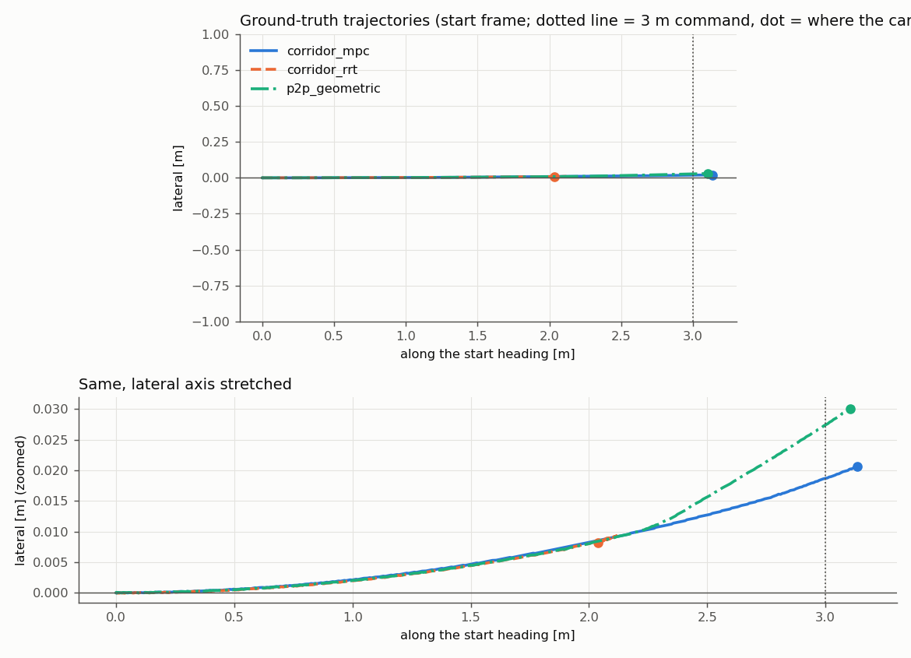
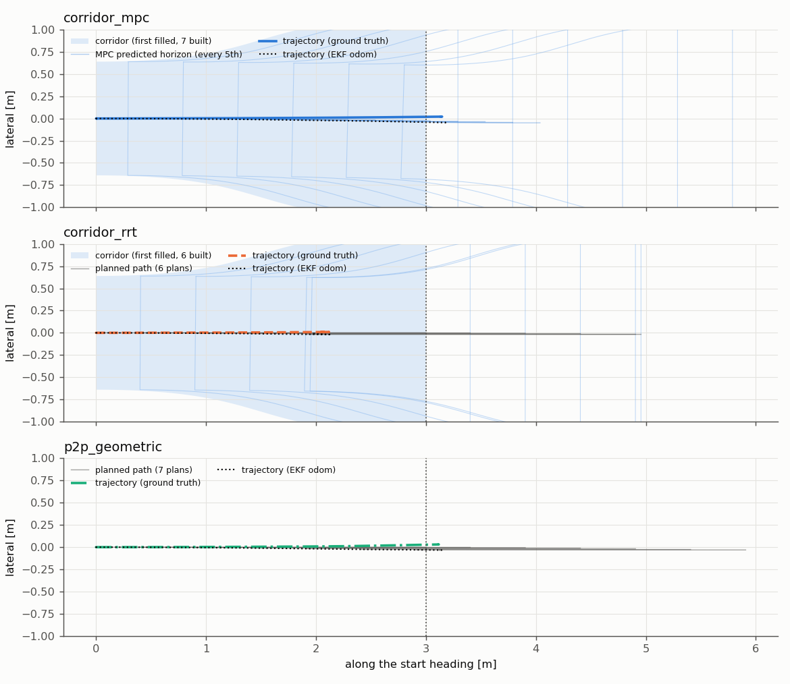
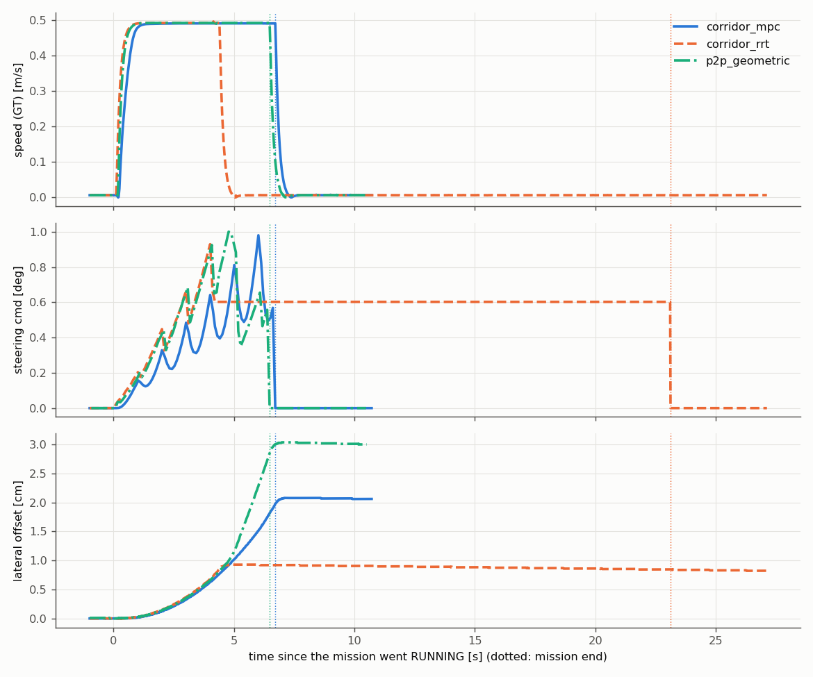
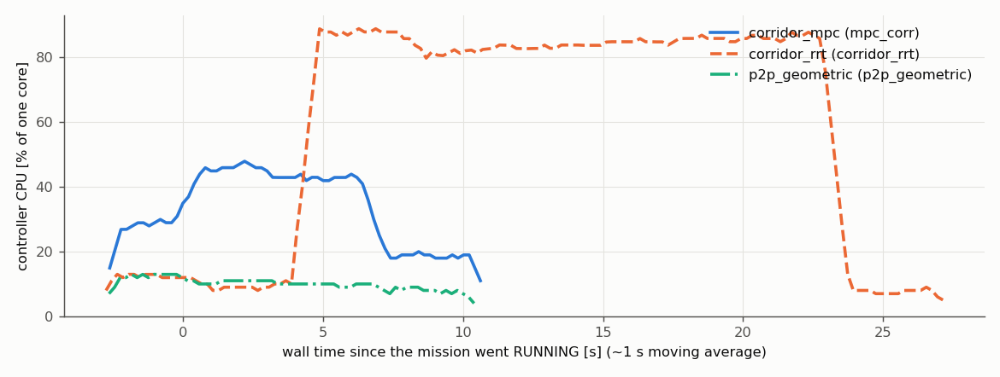

# Planner-controller comparison: "go straight 3m"

Session `20261113_140122`, host `DESKTOP-Q3F81S6`, scene `base_room` layout `campaign`, branch `planner-modes-hil` @ `22a960e`. One run per mode, the same command sent through the LLM planner each time.

The LLM produced the **same mission** for every mode (moves sha `86892f5ef777`):

```json
[
 {
  "id": "move_0_straight",
  "drive": {
   "mode": "straight",
   "speed": 0.5
  },
  "stop_condition": {
   "type": "distance_reached",
   "distance": 3.0
  },
  "timeout_sec": 23,
  "on_timeout": "abort",
  "terminal": true
 }
]
```

## Results

| metric | unit | corridor_mpc | corridor_rrt | p2p_geometric |
|---|---|---|---|---|
| mission result |  | COMPLETE | ABORTED | COMPLETE |
| mission duration | s | 6.72 | 23.12 | 6.48 |
| distance at mission COMPLETE | m | 3.074 | 2.052 | 3.043 |
| distance where the car stopped | m | 3.135 | 2.038 | 3.105 |
| stopped minus commanded | m | 0.135 | -0.962 | 0.105 |
| max lateral offset | m | 0.021 | 0.009 | 0.03 |
| RMS lateral offset (mission) | m | 0.008 | 0.008 | 0.011 |
| final heading error | deg | 0.92 | 0.74 | 1.54 |
| driven length | m | 3.16 | 2.202 | 3.13 |
| mean speed (mission) | m/s | 0.458 | 0.089 | 0.469 |
| max speed | m/s | 0.492 | 0.497 | 0.498 |
| mean |steering cmd| | deg | 0.37 | 0.56 | 0.48 |
| max |steering cmd| | deg | 0.98 | 0.93 | 1.0 |
| steering total variation | deg | 3.9 | 2.5 | 4.0 |
| reference tracked |  | corridor centreline | planned path | planned path |
| references published |  | 7 | 6 | 7 |
| max lateral of the reference | m | 0.058 | 0.017 | 0.032 |
| distance to reference, mean | m | 0.021 | 0.022 | 0.018 |
| distance to reference, max | m | 0.063 | 0.026 | 0.058 |
| EKF vs ground truth at the end | m | 0.068 | 0.075 | 0.065 |
| controller CPU, mission | % core | 44.3 | 71.2 | 10.1 |
| controller CPU, peak 1 s | % core | 47.9 | 88.8 | 11.0 |
| controller CPU, idle before | % core | 26.8 | 11.4 | 11.6 |
| controller CPU per sim second | ms | 442.6 | 714.3 | 100.5 |
| controller CPU per /drive msg | ms | 41.76 | 70.82 | 9.69 |
| /drive rate | Hz | 10.1 | 10.0 | 10.0 |
| replans (new modes) |  | - | 6 | 7 |
| plan time mean (wall) | ms | - | 1.06 | 0.34 |
| plan time p95 | ms | - | 1.31 | 0.38 |
| plan time max | ms | - | 1.37 | 0.38 |
| MPC solves |  | 66 | - | - |
| MPC solve success | % | 100.0 | - | - |
| MPC solve_dt mean (ROS clock) | ms | 0.0 | - | - |
| controller RSS | MB | 130.5 | 97.5 | 96.8 |
| sim real-time factor |  | 1.0 | 0.997 | 1.009 |
| host CPU busy (all cores) | % | 3.7 | 3.8 | 3.4 |
| LLM translation time | s | 18.9 | 18.682 | 18.842 |

Frame: the car's pose when the mission went RUNNING; x forward, y left. "stopped minus commanded" is ground truth against 3 m. CPU is the controller process from /proc (utime+stime, all threads) over the mission's wall-clock window; "per sim second" removes the sim's real-time factor.









## Notes

- **corridor_mpc**: mpc_corr solve_dt_sec is 0 throughout (ROS clock in sim time): use the process CPU columns for its cost
- **corridor_rrt**: mission ended ABORTED
