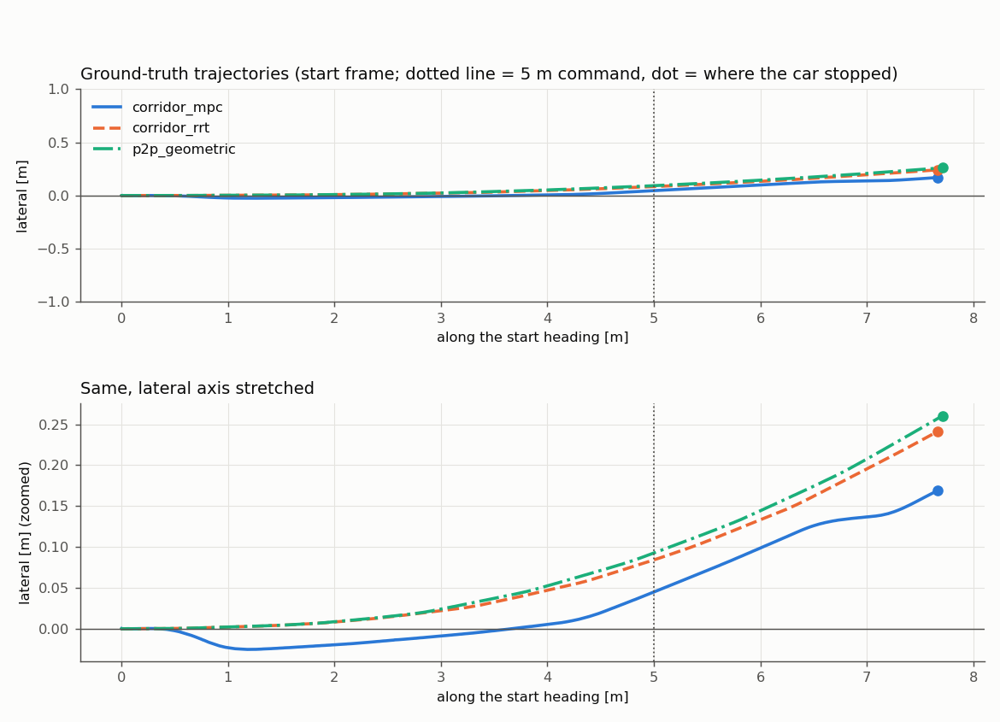
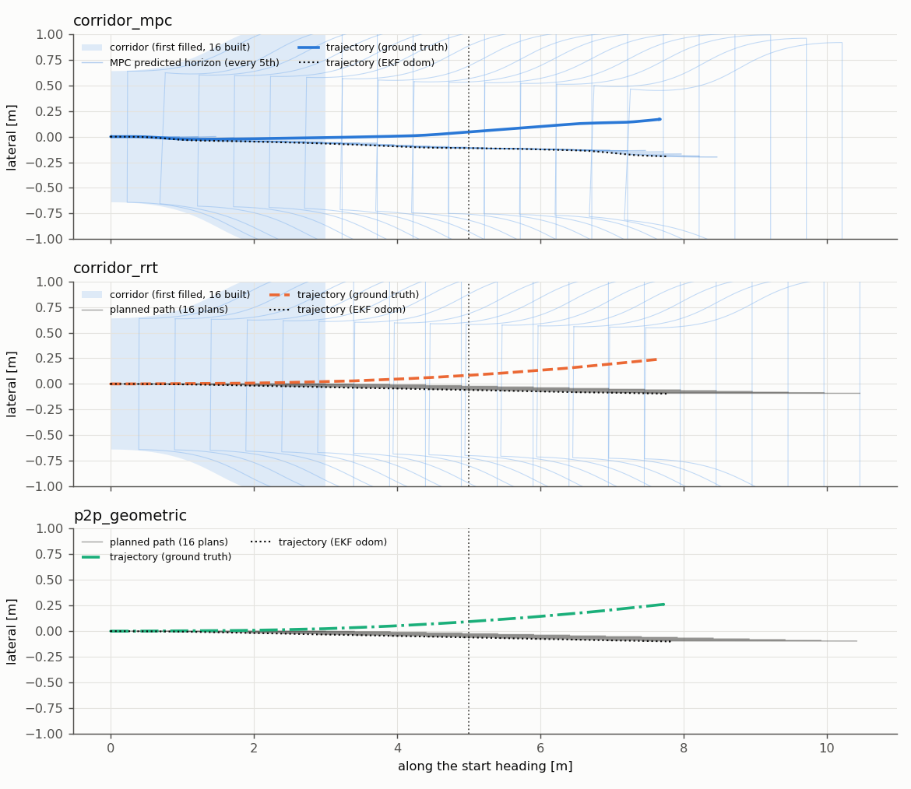
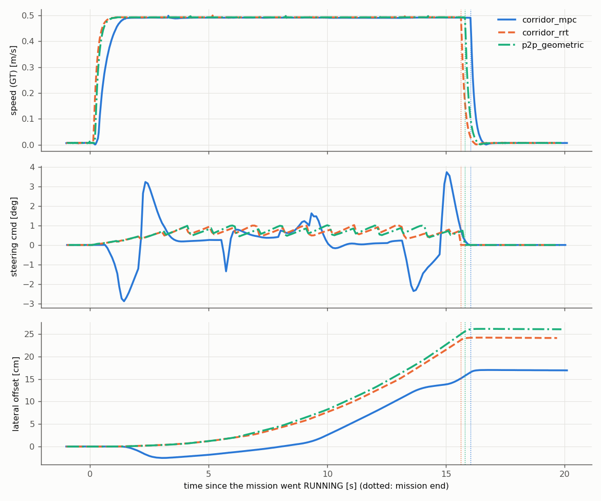
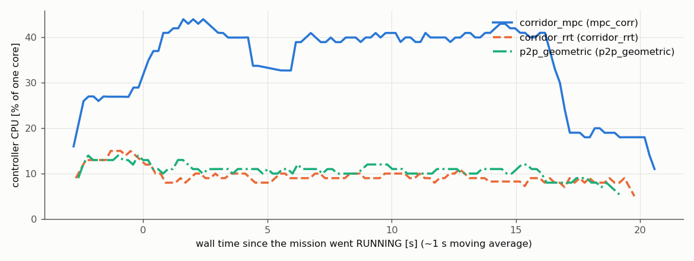

# Planner-controller comparison: "go straight 5m then enter the door on the left"

Session `door_20261113_150023`, host `DESKTOP-Q3F81S6`, scene `office` layout `door_left`, branch `planner-modes-hil` @ `e326bb4`. One run per mode, the same command sent through the LLM planner each time.

The LLM produced the **same mission** for every mode (moves sha `fa9e6540f521`):

```json
[
 {
  "id": "move_0_straight",
  "drive": {
   "mode": "straight",
   "speed": 0.5
  },
  "stop_condition": {
   "type": "distance_reached",
   "distance": 5.0
  },
  "timeout_sec": 35,
  "on_timeout": "abort"
 },
 {
  "id": "move_1_enter_door",
  "enter_door": {
   "type": "enter_door",
   "door": "left",
   "xy_tol": 0.15,
   "yaw_tol_deg": 10.0,
   "acquire_timeout_sec": 5.0,
   "approach_dist_m": 0.8
  },
  "stop_condition": {
   "type": "door_entered"
  },
  "timeout_sec": 65,
  "on_timeout": "abort",
  "terminal": true
 }
]
```

## Results

| metric | unit | corridor_mpc | corridor_rrt | p2p_geometric |
|---|---|---|---|---|
| mission result |  | ABORTED | ABORTED | ABORTED |
| mission duration | s | 16.03 | 15.63 | 15.8 |
| distance at mission COMPLETE | m | 7.604 | 7.602 | 7.65 |
| distance where the car stopped | m | 7.666 | 7.664 | 7.712 |
| stopped minus commanded | m | 2.666 | 2.664 | 2.712 |
| max lateral offset | m | 0.17 | 0.242 | 0.261 |
| RMS lateral offset (mission) | m | 0.067 | 0.098 | 0.106 |
| final heading error | deg | 4.06 | 4.14 | 4.39 |
| driven length | m | 7.697 | 7.696 | 7.745 |
| mean speed (mission) | m/s | 0.474 | 0.486 | 0.484 |
| max speed | m/s | 0.499 | 0.5 | 0.498 |
| mean |steering cmd| | deg | 0.8 | 0.62 | 0.63 |
| max |steering cmd| | deg | 3.73 | 1.03 | 1.01 |
| steering total variation | deg | 32.9 | 11.0 | 11.5 |
| reference tracked |  | corridor centreline | planned path | planned path |
| references published |  | 16 | 16 | 16 |
| max lateral of the reference | m | 0.235 | 0.092 | 0.097 |
| distance to reference, mean | m | 0.116 | 0.111 | 0.116 |
| distance to reference, max | m | 0.36 | 0.328 | 0.349 |
| EKF vs ground truth at the end | m | 0.367 | 0.344 | 0.368 |
| controller CPU, mission | % core | 38.6 | 8.8 | 10.7 |
| controller CPU, peak 1 s | % core | 43.9 | 11.0 | 13.0 |
| controller CPU, idle before | % core | 27.2 | 11.6 | 12.3 |
| controller CPU per sim second | ms | 400.2 | 89.7 | 104.1 |
| controller CPU per /drive msg | ms | 39.69 | 8.85 | 10.19 |
| /drive rate | Hz | 10.0 | 10.0 | 10.0 |
| replans (new modes) |  | - | 16 | 16 |
| plan time mean (wall) | ms | - | 1.07 | 0.33 |
| plan time p95 | ms | - | 1.16 | 0.35 |
| plan time max | ms | - | 1.36 | 0.37 |
| MPC solves |  | 159 | - | - |
| MPC solve success | % | 100.0 | - | - |
| MPC solve_dt mean (ROS clock) | ms | 0.0 | - | - |
| controller RSS | MB | 130.5 | 96.8 | 96.8 |
| sim real-time factor |  | 0.964 | 0.983 | 1.029 |
| host CPU busy (all cores) | % | 3.8 | 3.4 | 3.1 |
| LLM translation time | s | 19.433 | 20.169 | 20.219 |

Frame: the car's pose when the mission went RUNNING; x forward, y left. "stopped minus commanded" is ground truth against 5 m. CPU is the controller process from /proc (utime+stime, all threads) over the mission's wall-clock window; "per sim second" removes the sim's real-time factor.









## Notes

- **corridor_mpc**: mpc_corr solve_dt_sec is 0 throughout (ROS clock in sim time): use the process CPU columns for its cost
- **corridor_mpc**: mission ended ABORTED
- **corridor_rrt**: mission ended ABORTED
- **p2p_geometric**: mission ended ABORTED
