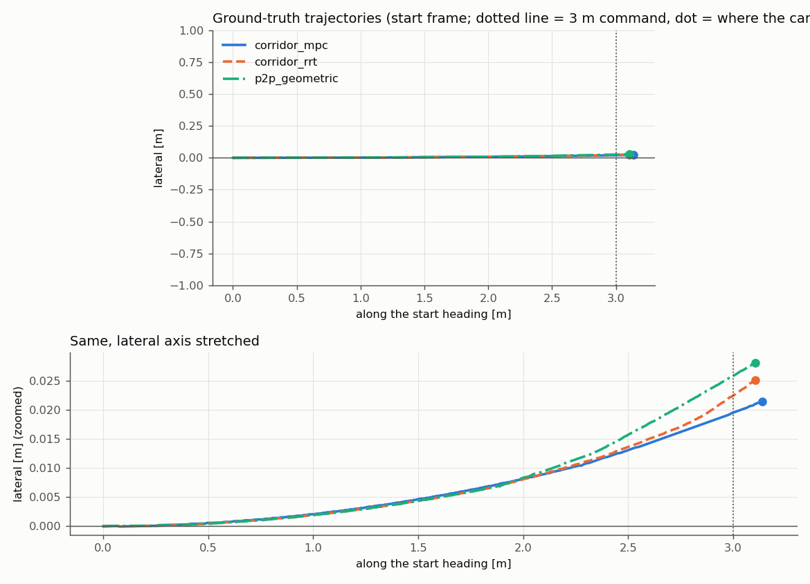
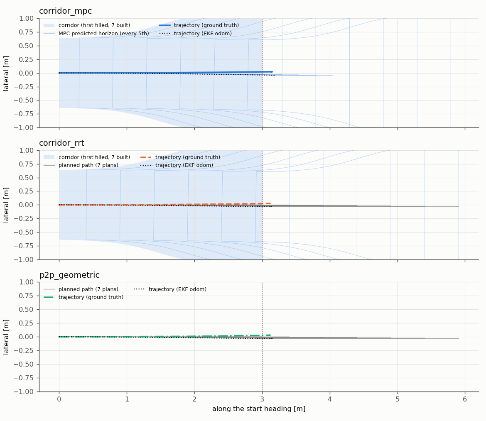
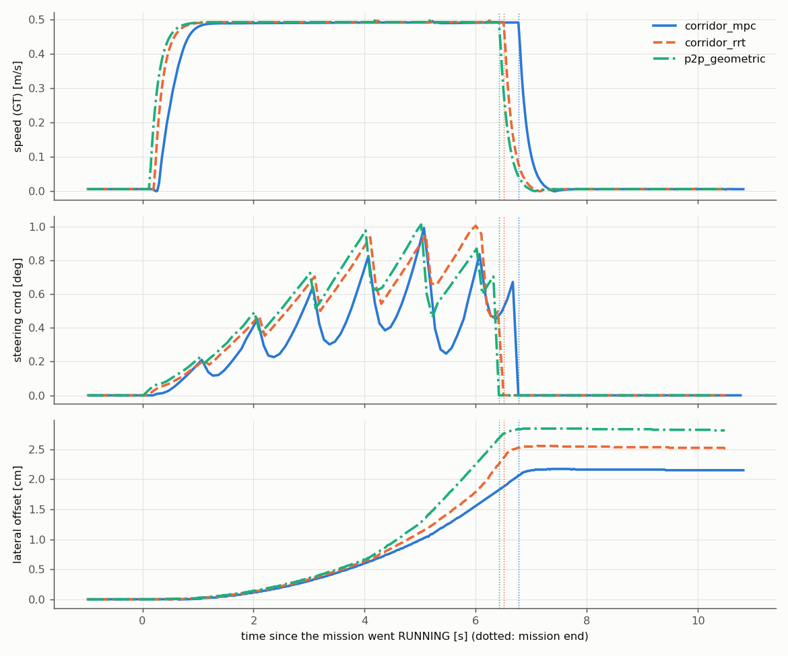
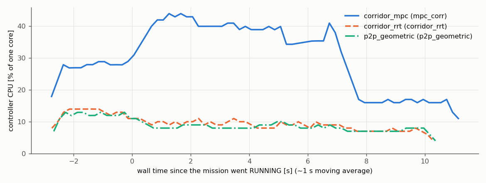

# Planner-controller comparison: "go straight 3m"

Session `final_20261113_143722`, host `DESKTOP-Q3F81S6`, scene `corridor` layout `matte`, branch `planner-modes-hil` @ `22a960e`. One run per mode, the same command sent through the LLM planner each time.

The LLM produced the **same mission** for every mode (moves sha `86892f5ef777`):

```json
[
 {
  "id": "move_0_straight",
  "drive": {
   "mode": "straight",
   "speed": 0.5
  },
  "stop_condition": {
   "type": "distance_reached",
   "distance": 3.0
  },
  "timeout_sec": 23,
  "on_timeout": "abort",
  "terminal": true
 }
]
```

## Results

| metric | unit | corridor_mpc | corridor_rrt | p2p_geometric |
|---|---|---|---|---|
| mission result |  | COMPLETE | COMPLETE | COMPLETE |
| mission duration | s | 6.77 | 6.5 | 6.42 |
| distance at mission COMPLETE | m | 3.077 | 3.043 | 3.043 |
| distance where the car stopped | m | 3.138 | 3.105 | 3.105 |
| stopped minus commanded | m | 0.138 | 0.105 | 0.105 |
| max lateral offset | m | 0.022 | 0.026 | 0.028 |
| RMS lateral offset (mission) | m | 0.009 | 0.009 | 0.011 |
| final heading error | deg | 0.93 | 1.52 | 1.35 |
| driven length | m | 3.164 | 3.131 | 3.13 |
| mean speed (mission) | m/s | 0.455 | 0.468 | 0.474 |
| max speed | m/s | 0.495 | 0.498 | 0.498 |
| mean |steering cmd| | deg | 0.38 | 0.51 | 0.52 |
| max |steering cmd| | deg | 0.99 | 1.0 | 1.01 |
| steering total variation | deg | 5.8 | 4.2 | 4.5 |
| reference tracked |  | corridor centreline | planned path | planned path |
| references published |  | 7 | 7 | 7 |
| max lateral of the reference | m | 0.052 | 0.033 | 0.032 |
| distance to reference, mean | m | 0.02 | 0.018 | 0.018 |
| distance to reference, max | m | 0.059 | 0.056 | 0.058 |
| EKF vs ground truth at the end | m | 0.065 | 0.062 | 0.065 |
| controller CPU, mission | % core | 37.8 | 9.2 | 8.4 |
| controller CPU, peak 1 s | % core | 43.9 | 11.0 | 10.0 |
| controller CPU, idle before | % core | 25.6 | 12.6 | 11.6 |
| controller CPU per sim second | ms | 400.0 | 90.5 | 83.9 |
| controller CPU per /drive msg | ms | 38.24 | 8.64 | 8.0 |
| /drive rate | Hz | 10.0 | 10.2 | 10.1 |
| replans (new modes) |  | - | 7 | 7 |
| plan time mean (wall) | ms | - | 1.01 | 0.34 |
| plan time p95 | ms | - | 1.21 | 0.38 |
| plan time max | ms | - | 1.29 | 0.38 |
| MPC solves |  | 66 | - | - |
| MPC solve success | % | 100.0 | - | - |
| MPC solve_dt mean (ROS clock) | ms | 0.0 | - | - |
| controller RSS | MB | 129.8 | 96.0 | 96.0 |
| sim real-time factor |  | 0.945 | 1.014 | 0.997 |
| host CPU busy (all cores) | % | 4.2 | 3.8 | 3.7 |
| LLM translation time | s | 18.63 | 18.45 | 18.963 |

Frame: the car's pose when the mission went RUNNING; x forward, y left. "stopped minus commanded" is ground truth against 3 m. CPU is the controller process from /proc (utime+stime, all threads) over the mission's wall-clock window; "per sim second" removes the sim's real-time factor.









## Notes

- **corridor_mpc**: mpc_corr solve_dt_sec is 0 throughout (ROS clock in sim time): use the process CPU columns for its cost
