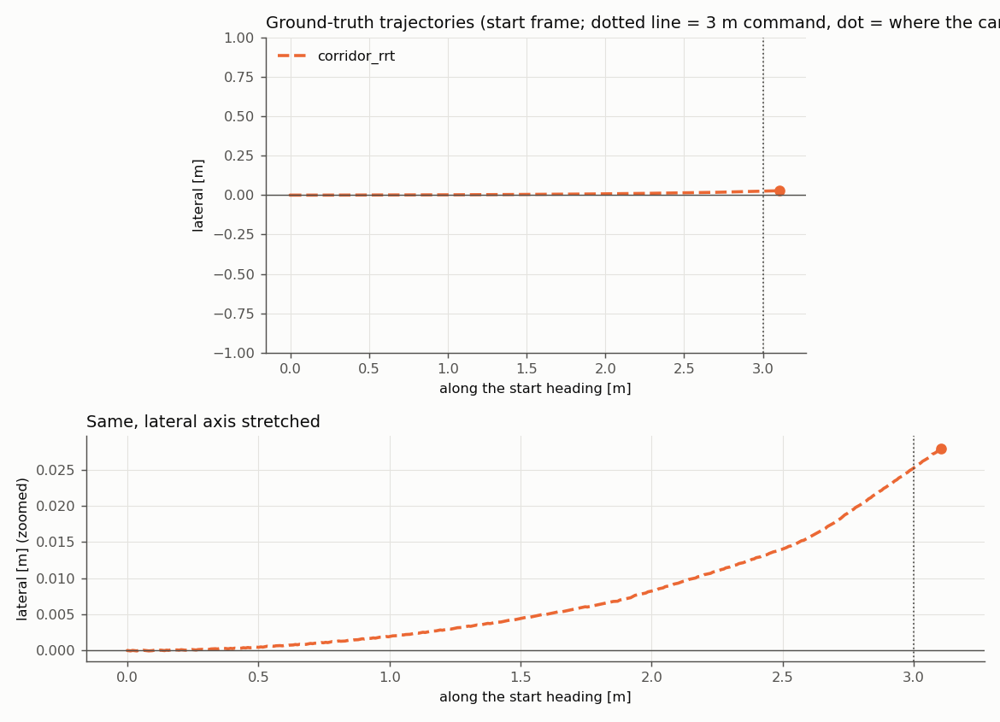
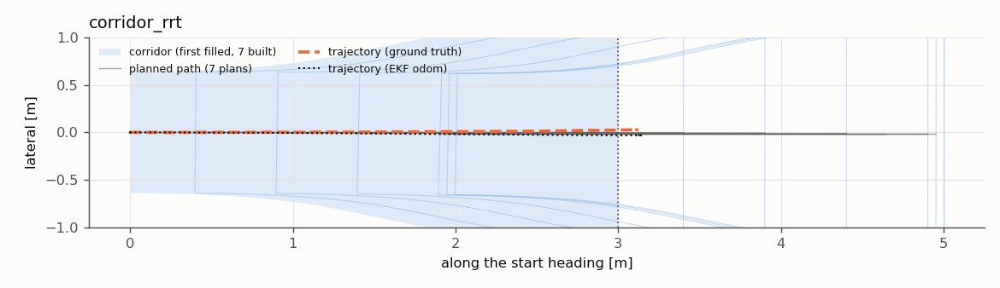
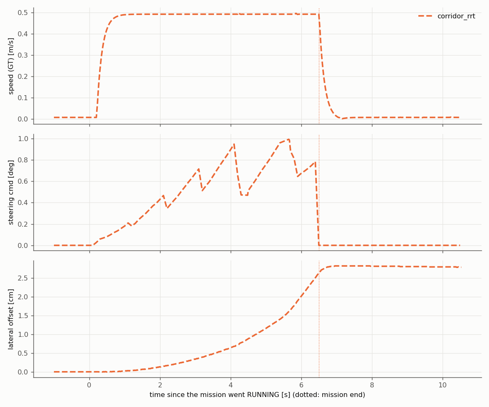
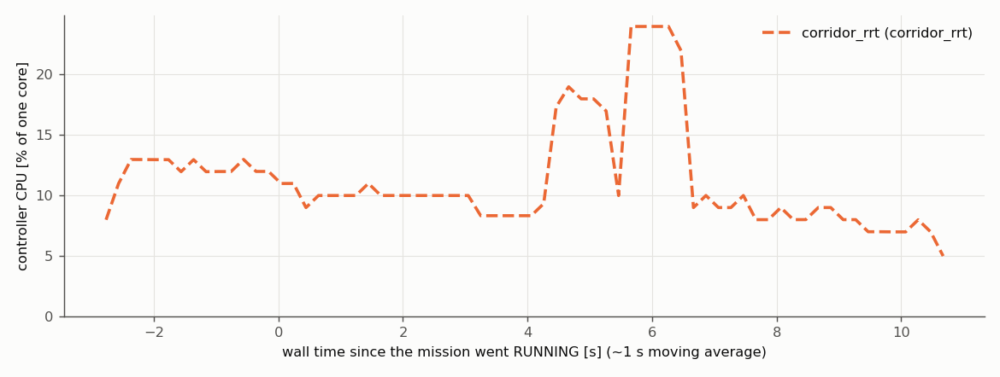

# Planner-controller comparison: "go straight 3m"

Session `retreat_on_142913`, host `DESKTOP-Q3F81S6`, scene `base_room` layout `campaign`, branch `planner-modes-hil` @ `22a960e`. One run per mode, the same command sent through the LLM planner each time.

The LLM produced the **same mission** for every mode (moves sha `86892f5ef777`):

```json
[
 {
  "id": "move_0_straight",
  "drive": {
   "mode": "straight",
   "speed": 0.5
  },
  "stop_condition": {
   "type": "distance_reached",
   "distance": 3.0
  },
  "timeout_sec": 23,
  "on_timeout": "abort",
  "terminal": true
 }
]
```

## Results

| metric | unit | corridor_rrt |
|---|---|---|
| mission result |  | COMPLETE |
| mission duration | s | 6.5 |
| distance at mission COMPLETE | m | 3.043 |
| distance where the car stopped | m | 3.105 |
| stopped minus commanded | m | 0.105 |
| max lateral offset | m | 0.028 |
| RMS lateral offset (mission) | m | 0.01 |
| final heading error | deg | 1.58 |
| driven length | m | 3.131 |
| mean speed (mission) | m/s | 0.468 |
| max speed | m/s | 0.5 |
| mean |steering cmd| | deg | 0.51 |
| max |steering cmd| | deg | 0.99 |
| steering total variation | deg | 3.9 |
| reference tracked |  | planned path |
| references published |  | 7 |
| max lateral of the reference | m | 0.02 |
| distance to reference, mean | m | 0.017 |
| distance to reference, max | m | 0.046 |
| EKF vs ground truth at the end | m | 0.061 |
| controller CPU, mission | % core | 12.5 |
| controller CPU, peak 1 s | % core | 24.0 |
| controller CPU, idle before | % core | 11.8 |
| controller CPU per sim second | ms | 132.4 |
| controller CPU per /drive msg | ms | 12.58 |
| /drive rate | Hz | 10.2 |
| replans (new modes) |  | 7 |
| plan time mean (wall) | ms | 12.68 |
| plan time p95 | ms | 57.8 |
| plan time max | ms | 81.97 |
| controller RSS | MB | 97.4 |
| sim real-time factor |  | 0.946 |
| host CPU busy (all cores) | % | 4.1 |
| LLM translation time | s | 19.592 |

Frame: the car's pose when the mission went RUNNING; x forward, y left. "stopped minus commanded" is ground truth against 3 m. CPU is the controller process from /proc (utime+stime, all threads) over the mission's wall-clock window; "per sim second" removes the sim's real-time factor.








