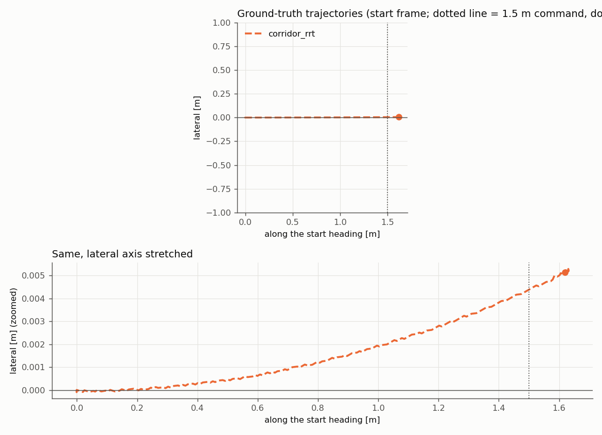
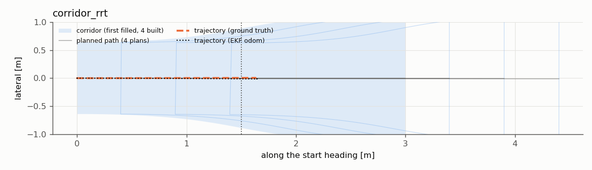
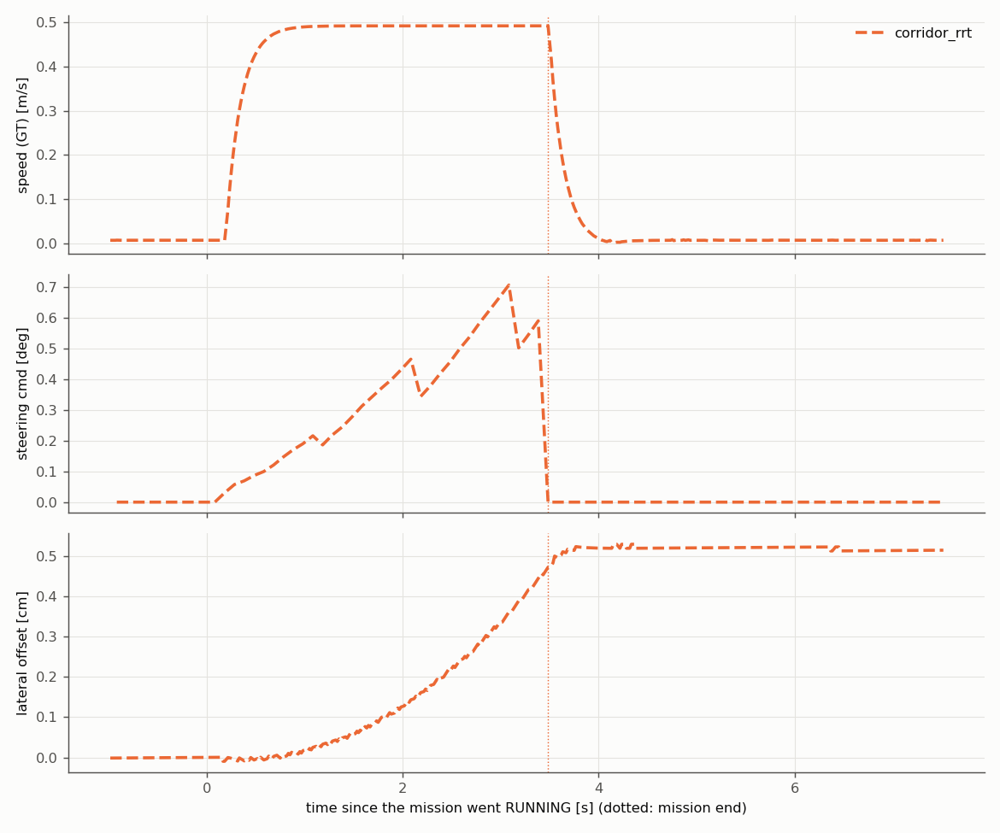
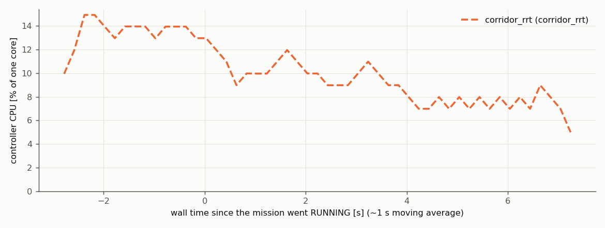

# Planner-controller comparison: "go straight 1.5m"

Session `rrt_test_1m5_141256`, host `DESKTOP-Q3F81S6`, scene `base_room` layout `campaign`, branch `planner-modes-hil` @ `22a960e`. One run per mode, the same command sent through the LLM planner each time.

The LLM produced the **same mission** for every mode (moves sha `3e0265e318c6`):

```json
[
 {
  "id": "move_0_straight",
  "drive": {
   "mode": "straight",
   "speed": 0.5
  },
  "stop_condition": {
   "type": "distance_reached",
   "distance": 1.5
  },
  "timeout_sec": 14,
  "on_timeout": "abort",
  "terminal": true
 }
]
```

## Results

| metric | unit | corridor_rrt |
|---|---|---|
| mission result |  | COMPLETE |
| mission duration | s | 3.48 |
| distance at mission COMPLETE | m | 1.557 |
| distance where the car stopped | m | 1.619 |
| stopped minus commanded | m | 0.119 |
| max lateral offset | m | 0.005 |
| RMS lateral offset (mission) | m | 0.002 |
| final heading error | deg | 0.47 |
| driven length | m | 1.645 |
| mean speed (mission) | m/s | 0.447 |
| max speed | m/s | 0.493 |
| mean |steering cmd| | deg | 0.32 |
| max |steering cmd| | deg | 0.71 |
| steering total variation | deg | 1.9 |
| reference tracked |  | planned path |
| references published |  | 4 |
| max lateral of the reference | m | 0.011 |
| distance to reference, mean | m | 0.004 |
| distance to reference, max | m | 0.015 |
| EKF vs ground truth at the end | m | 0.018 |
| controller CPU, mission | % core | 10.0 |
| controller CPU, peak 1 s | % core | 12.0 |
| controller CPU, idle before | % core | 12.2 |
| controller CPU per sim second | ms | 98.5 |
| controller CPU per /drive msg | ms | 9.14 |
| /drive rate | Hz | 10.0 |
| replans (new modes) |  | 4 |
| plan time mean (wall) | ms | 1.12 |
| plan time p95 | ms | 1.31 |
| plan time max | ms | 1.35 |
| controller RSS | MB | 96.8 |
| sim real-time factor |  | 1.013 |
| host CPU busy (all cores) | % | 5.0 |
| LLM translation time | s | 18.624 |

Frame: the car's pose when the mission went RUNNING; x forward, y left. "stopped minus commanded" is ground truth against 1.5 m. CPU is the controller process from /proc (utime+stime, all threads) over the mission's wall-clock window; "per sim second" removes the sim's real-time factor.








