# MPC "dodge" in Isaac: report della notte 2026-11-18

Lavoro unattended su linus (prompt "MPC dodge" e addendum 2b). Branch:

| cosa | branch | commit |
|---|---|---|
| solo stack (MPC, semantic layer, messaggi), per l'Orin | `mpc-dodge-mpc` (da `mpc-centerline-target-linus`) | vedi §10 |
| harness + MPC mergiato | `isaac-mpc-tuning` | vedi §10 |
| Isaac (layout `dodge`, moto pingpong/waypoints, persone mobili) | `~/isaac_ws` `mpc-tuning` | `05341ed`, `74b07dd` |

Non ho toccato `origin/mpc-centerline-target`, `main`, `campaign-final` né il checkout `~/dev_ws/f1tenth_more`. Nessun force push, nessuna bag.

## 0. In breve

- **Fase 0–1.** L'MPC di oggi non schiva ostacoli in moto. M1–M4 dà 3/12 run buoni (solo M4). La rampa dodge ha **d_fail = 0**: 5/18 run buoni sui livelli 0–2. L'auto scarta di 1–2 m nel verso in cui va il cilindro, oppure si ferma per lo stop a 20 cm e il cilindro le arriva addosso.
- **Fase 2: la velocità dell'ostacolo funziona**, ma solo dopo aver corretto un mio bug: il primo filtro toglieva la velocità ai cilindri, e il primo A/B e il primo loop non valgono.
  - **Misura:** velocità per traccia in odom locale, compensata dal moto proprio. Sui cilindri è valida nel 94 % dei casi, con errore mediano 0.06 m/s.
  - **Dischi predetti (α = 1):** dodge da 5/18 a 9/18, M da 3/12 a 7/12, M1 da 0/3 a 3/3.
  - **Con la scia:** dodge **12/18** e M **9/12**, **d_fail = 1**.
  - **Regola di lato informata da sola:** peggiora (4/18, M 2/12), non la consiglio.
  - **Sonde sul corpo** (aggiunta mia dopo la diagnosi): α + scia + sonde dà 13/18, M 8/12, S invariato, e nessuna collisione nei 18 run dodge.
- **Fase 2b: il ritorno funziona** come arco di ritorno: la versione "solo pesi" oscillava (0.32 m di overshoot). Sugli statici lo scarto finale scende da ~1.2 m a 0.35–0.6 m, overshoot 0, run buoni e clearance invariati. `corridor_lateral_reanchor` resta `true` (oggi) di default: vedi §2.5.
- **Fase 3 non fatta in modo valido.** L'unico loop è girato con la velocità rotta (5 iterazioni, nessun miglioramento). Il loop rifatto era pronto ma la sessione si è chiusa prima di lanciarlo: comando in §8.
- **Fase 4 fatta.** Persone mobili in Isaac, riconosciute da YOLO con gli oggetti LiDAR spenti come sull'auto. P1, P3 e P4 danno 3/3, P2 (frontale) 0/2. Rispetto alla modalità unknown, una persona in moto resta nella lista ostacoli per meno tempo (48 % contro 72 % in vista) e sparisce appena esce dal campo visivo.
- **Resta aperto:** d = 2 è un muro per tutte le varianti (≤ 3/6), M3/S4 vanno in e-stop a margine ≈ 0, gli ostacoli frontali (M2/P2) restano un problema, e il loop è da rifare con un criterio che regga il rumore.

**Il meccanismo in una figura** (rig closed-loop, cilindro che attraversa da destra). L'MPC di oggi vede ogni tick una "fotografia" dei dischi: scarta nel verso in cui il cilindro sta andando e gli finisce addosso. Con i dischi predetti (α = 1) passa dietro al cilindro scartando di 0.3 m invece di 2.4 m, con 0.32 m di margine sul R_safe.

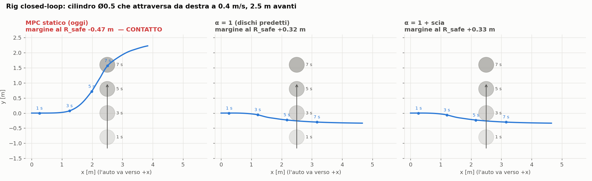

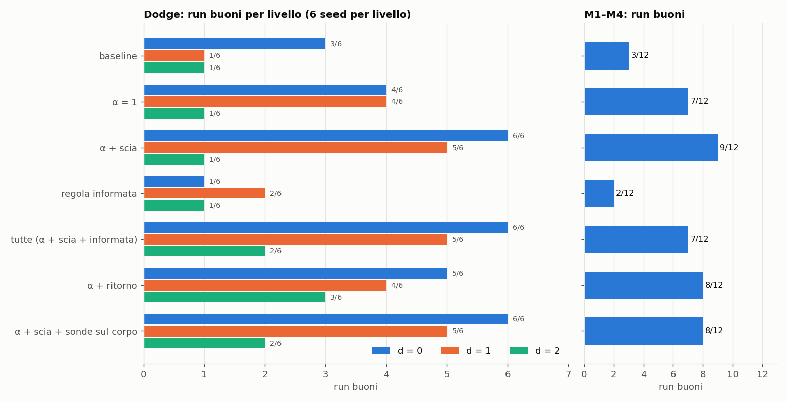

## 1. Fase 0 e Fase 1: baseline

### Fase 0: M1–M4 ×3 con l'MPC attuale

| scenario | buoni | esiti | margine al R_safe [m] |
|---|---|---|---|
| M1 attraversa da destra, 0.4 m/s | 0/3 | e-stop, e-stop, collisione | −0.02, −0.02, −0.09 |
| M2 frontale, 0.25 m/s | 0/2 (+1 non valido) | collisione, successo | −0.20, −0.08 |
| M3 attraversa da sinistra, 0.5 m/s | 0/3 | e-stop ×3 | +0.02, +0.01, −0.02 |
| M4 entra e si ferma sulla linea | 3/3 | successo ×3 | +0.17, +0.18, +0.06 |

(`output/isaac_tuning/dodge/phase0_M/`). La baseline ripetuta nell'A/B con il nuovo build e tutti i flag spenti dà gli stessi numeri: M 3/12 (M4 3/3, il resto 0/3), S 9/13 contro i 3+3+2+0+1 dell'iterazione 1 del handoff. **Nessun cambiamento con i flag spenti.**

Gli **e-stop** di M1/M3 non sono collisioni. L'auto passa a ~0 dal R_safe, cioè a 0.07 m di corpo, e scatta il safety stop LiDAR a 20 cm (`IsProximityTooClose` del BT e `hard_stop`). Il disco da 0.20 m attorno al centro asse non copre gli spigoli del muso.

### Fase 1: d_fail di baseline

**d_fail = 0.** Già al livello 0 (cilindri a 0.2 m/s, 2 livelli, niente diagonali) l'MPC di oggi non è affidabile. Su 6 seed per livello passano 3/6 a d0, 1/6 a d1 e 1/6 a d2, cioè 5/18. Il primo ramp a 3 seed aveva 1/3 a d0. Il meccanismo si vede bene in `dodge_baseline_d00.png`: l'MPC statico vede il cilindro come un disco fermo, scarta di 2 m dalla parte verso cui il cilindro sta andando e finisce sulla traiettoria del livello successivo. Il fallimento arriva al livello 1, a ~7 s, con la clearance del corpo a 0.

Com'è uno scenario dodge (d = 3, tre livelli, uno diagonale; camera spettatore, run di prova con l'MPC di oggi):

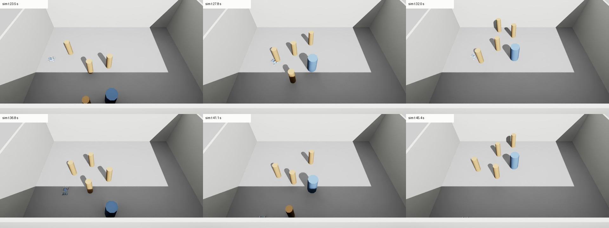

Baseline al livello 0 (primo ramp) e al livello 1 (6 seed); le linee grigie sono le corse dei cilindri, il disco è dove si trovano alla fine:

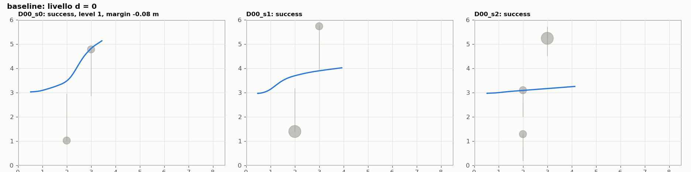

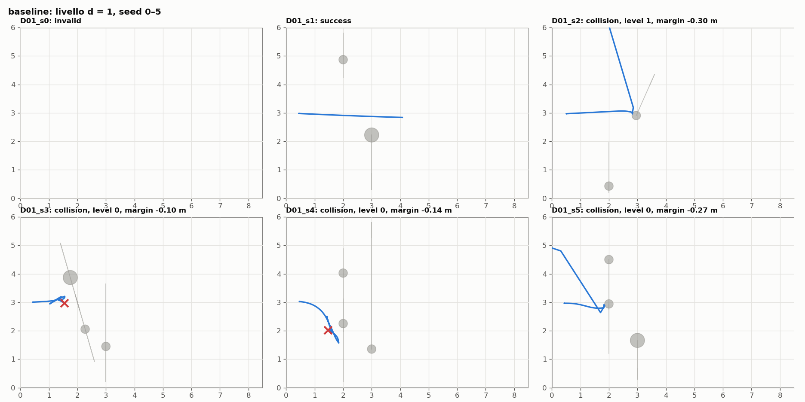

## 2. Cosa è stato costruito

### 2.1 Scenario "dodge" D(d, seed) (Fase 1)

- **Layout Isaac `dodge`** (`~/isaac_ws`, branch `mpc-tuning`, commit `05341ed`): la stanza `tuning` allungata a 8.5 × 6 m (stessa larghezza, auto sempre a (0.5, 3.0)), con un pool di 10 cilindri Ø0.3 e 10 Ø0.5 parcheggiati sotto il pavimento. Gli scenari S/M restano sul layout `tuning`: il runner riavvia Isaac quando cambia layout (≈25 s).
- **Moto "pingpong"** (`sim/motion.py`): avanti e indietro su un segmento a → b a velocità costante, avviato da `/sim/scenario_go`. La stessa formula sta in `common.motion_position`; un test carica il file di Isaac e verifica che coincidano.
- **Generatore** (`scripts/sim/isaac_tuning/dodge.py`), deterministico, scrive `scenarios/dodge/Ddd_sN.json`:
  - livelli a 1.5, 2.5, 3.5, 4.5, 5.5 m davanti alla partenza nominale; missione = ultimo livello + 1.0 m (3.5–6.5 m), timeout = distanza/velocità + 8 s;
  - per livello 1 cilindro, o una **coppia rigida** (35 %, distanza 1.2–2.0 m lungo il moto: due cilindri sullo stesso segmento non si attraversano mai), Ø0.5 nel 25 % dei casi;
  - verso iniziale alternato tra livelli; **diagonali** 15–35° dall'asse laterale, segmento tagliato a ±0.6 m attorno al livello (altrimenti a 35° un cilindro attraversa tutta la stanza in x);
  - rampa: velocità `0.2 + 0.1·d` (tetto 1.5), quota diagonali `min(0.5, 0.1·d)`, livelli `2 + d//3` (tetto 5).
- **Oracolo di fattibilità**: reticolo (x, y, ψ, δ) con bicicletta cinematica a 0.5 m/s, δ ≤ 0.319 rad e |δ̇| ≤ 0.5 rad/s (i limiti dell'MPC), ritardo di partenza 0.6 s (misurato: v ≥ 0.2 m/s a ~0.5 s, ≥ 0.4 a ~0.75 s), centro auto ≥ R_safe_ref dai cilindri valutati a t e a t ± 0.25 s (un percorso che funziona solo con il tempismo perfetto non conta), ≥ 0.45 m dalle pareti. Se non arriva alla distanza della missione, il candidato è scartato e si passa al seed successivo (`seed·1000 + 100 000·d + tentativo`). È un limite superiore: l'oracolo conosce il futuro.
- **Metriche nuove** in `run.json`: per ostacolo livello, tempo e clearance del corpo; `failure` (ostacolo, livello, margine, istante, saturazione dello sterzo δ e δ̇ nei 1.5 s prima); `steer_sat` sull'intero run; `return` (vedi 2b).
- **Runner**: `ramp.py` (sale fino al primo d che fallisce), `evaluate.py` (A/B per varianti: rampa + M1–M4 ×3 + S1–S4 ×3 + S5), `tuning/dodge_loop.py` (Fase 3).

### 2.2 Velocità per `id` (Fase 2, punto 1)

**Dove vive il tracker.** Non c'è un "tracker veloce" separato: c'è un'unica lista di tracce in `semantic_layer_node` (`f1tenth_costmap`), alimentata dalle detection YOLO (`update_tracks_batch`) e dai cluster LiDAR (`update_unknown_batch`, 10 Hz). **Una stima esiste già (`vx_map`, `vy_map`), ma non è usabile:** solo le detection della camera la aggiornano (le tracce "unknown" del LiDAR hanno sempre v = 0), è in frame **map** (eredita i salti di SLAM), è calcolata contro la posizione già filtrata con EMA (per moto costante converge a v/α ≈ 3.3 v con α = 0.3), serve solo per l'associazione e non viene pubblicata.

**Implementazione** (`f1tenth_costmap/track_velocity.py`, flag `semantic_track_velocity_enabled`, default off):
- filtro di Kalman a velocità costante per `id` (stato x, y, vx, vy; rumore di accelerazione 1.5 m/s², misura 5 cm);
- **la misura è quella grezza** di ogni aggiornamento (centroide del cluster LiDAR prima dell'EMA, detection della camera), riportata in base_link con l'**inverso esatto** della posa map con cui il nodo l'aveva messa in map, e poi in **odom locale al timestamp della misura** (storia di `/odometry/filtered` interpolata). La posa map si cancella: nessun salto map→odom entra nella stima, e il moto proprio è compensato (si differenziano posizioni già in odom, mai in base_link: un test lo verifica con un'auto che curva);
- un oggetto rotondo visto dal LiDAR è un mezzo arco con centroide 2r/π verso il sensore, che ruota mentre l'auto passa: il centroide viene spostato indietro lungo il rilevamento prima di entrare nel filtro;
- `v_valid` = traccia vecchia ≥ 0.5 s, |v| > 0.1 m/s, σ_v < 0.25 m/s; nuovo `id` = nuovo filtro; un buco > 1 s riparte da zero;
- **i cluster lunghi e sottili non sono mai `v_valid`** (rapporto lunghezza/larghezza > `track_velocity_max_aspect` = 3.5, larghezza minima 0.1 m): in Isaac un pezzo di parete dietro l'auto mostrava 0.29 m/s con σ sotto soglia, perché il centroide scorre lungo la parte visibile (rapporto ~6). **Il primo filtro era sbagliato.** Usava il criterio delle catene di dischi (> 1.5), che prende anche ogni cilindro visto dal LiDAR (mezzo arco, rapporto ~2). Così nel primo A/B solo l'1 % dei dischi sui cilindri in moto era `v_valid`, e le varianti "con velocità" giravano di fatto con l'MPC statico. Corretto in `33c4119b` (94 %, errore mediano 0.05 m/s) e A/B rifatto (§3).

**Messaggi.** `Obstacle2D`: `id` (default −1), `vx`, `vy` (odom), `speed`, `heading`, `v_sigma`, `vx_car`, `vy_car` (solo debug, assi dell'auto), `v_valid`. `SemanticObject`: `vx_odom`, `vy_odom`, `speed`, `heading_odom`, `v_cov[4]`, `vx_car`, `vy_car`, `v_valid`. `obstacle_projector_node` lascia i default. **Conseguenza:** le bag vecchie con `/perception/obstacles_2d` non si decodificano più con il nuovo typesupport (gli strumenti di replay in `tools/` e `mission_extract.py` usano quello installato); serve un decoder legacy come quello che `mission_extract.py` ha già per `MpcSolverStatus`.

**Verifica in Isaac.** Su M1 con α = 1 il cilindro a +0.40 m/s laterali è stimato a (0.0 ± 0.08, 0.35–0.44) m/s, `v_valid` mentre si muove e non valido da fermo. Sui run dodge dopo la correzione del filtro, il 94 % dei dischi su un cilindro in moto è `v_valid`, con errore di velocità mediano 0.05 m/s (p90 0.20) e distanza mediana tra centro del disco e centro del cilindro di 0.18 m (è l'arco visibile, non il centro).

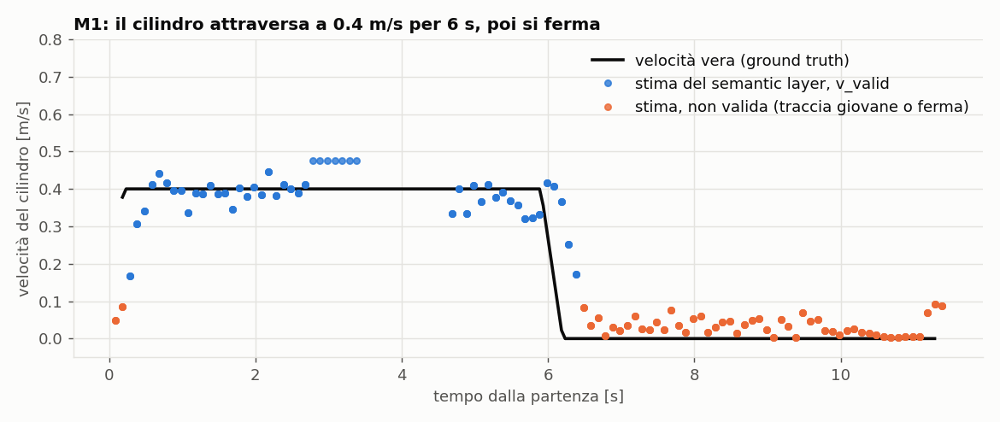

La stima segue i 0.4 m/s del cilindro e si spegne (non valida) quando si ferma. I primi ~0.5 s dopo la nascita della traccia non è valida per costruzione (`min_age_s`).

### 2.3 Dischi predetti e scia (Fase 2, punto 2)

`mpc_controller/obstacle_motion.py` + `mpc_solver.py`, tutto off di default (il QP resta identico operazione per operazione):
- **`mpc_obs_vel_trust` α**: allo stadio k il disco di un ostacolo `v_valid` è in `p + α·v·t_k`, con `t_k` il tempo dello stato dello stadio (periodo di controllo + k·dt), più `mpc_obs_vel_lead_s` (latenza, default 0) e con tetto `mpc_obs_pred_max_s` (2 s: la velocità costante non è una previsione a 4 s). Stesso costo soft `w_obs`, stessi margini.
- **Scia** (`mpc_obs_wake_weight`, `mpc_obs_wake_horizon_s`): 4 dischi che disegnano una mezza ellisse davanti al moto (semiasse |v|·T, semiasse minore r; il margine dell'auto lo aggiunge il costo), con un peso proprio scalato per stadio come `w_obs`. Solo per ostacoli che si **avvicinano** all'auto (v·(p − auto) < 0). Nessun termine spinge l'auto in una direzione.
- Con `mpc_solver_impl rust` la combinazione viene rifiutata (il core Rust prende una sola lista per tutti gli stadi).

### 2.3b Sonde sul corpo (`mpc_obs_body_probes`, aggiunta dopo la diagnosi della Fase 3)

Il costo ostacolo valuta solo punti **davanti al muso**. Circa un terzo dei fallimenti dodge è un cilindro che si chiude sul fianco o sulla coda di un'auto lanciata a 0.5 m/s, e quei punti non lo vedono più una volta che il muso è passato. Con il flag acceso, il termine ostacolo di ogni stadio valuta anche il paraurti posteriore e il centro asse (`base_link + offset·heading`, lo stesso meccanismo delle sonde posteriori della retromarcia). Default off; con Rust viene rifiutato come gli altri termini per stadio. Nel rig, sui due casi "fianco" con α = 1, il margine passa da −0.04/−0.08 m a +0.09/+0.08 m, e il caso S1 statico da −0.004 a +0.014 m.

### 2.4 Regola di lato informata (Fase 2, punto 3)

`side_rule.break_ties_informed`, `mpc_obstacle_side_mode: informed` (default `fixed` = la regola di oggi). Per un ostacolo nella banda (5 cm): (1) |v_lat| > 0.1 m/s → lato opposto al segno di v_lat (dietro di lui); (2) fermo → il lato da cui è arrivato (l'ultimo lato su cui la traccia è stata vista fuori banda); (3) il lato con più spazio (pareti del costmap e altri ostacoli a ±1 m lungo la linea); (4) `mpc_obstacle_tie_side`. **Latch** per traccia e per mossa, rilasciato oltre `mpc_obstacle_side_release_m` (0.15 m); una nuova mossa azzera tutto.

### 2.5 Ritorno sulla centerline (Fase 2b)

**Cosa proteggeva il ri-ancoraggio.** Dalla sua nota: la linea ancorata in map e riproiettata in odom a ogni tick saltava a ogni correzione SLAM, e il corridoio tremava. La deriva di heading (13° misurati) è corretta dall'heading congelato in map, che resta. **Non proteggeva da una deriva di odom.** Con la linea tenuta in odom locale l'unico prezzo è che una deriva di *posizione* dell'odom nel corso della mossa sposta la linea con l'auto (EKF ruote + IMU su pochi metri: piccola ma non misurata qui).

`lateral_return.py`, flag `corridor_lateral_reanchor` (**true = oggi**, vedi nota sotto). Con false:
- l'origine della linea è la posizione odom dell'auto al primo corridoio della mossa; la direzione è l'heading congelato della mossa; un rebuild fa avanzare il corridoio solo **lungo** la linea (origine = piede della perpendicolare);
- con |e| ≥ 0.10 m e niente ostacoli tra auto e linea: **arco di ritorno**, il corridoio "pose" già usato da `goal_pose` (cubica) dalla posa dell'auto al punto della linea a D = `mpc_return_lookahead_ratio`·|e| davanti, che arriva parallelo alla linea (stile pure pursuit). D è limitato dall'angolo massimo (`mpc_return_max_heading_deg`, e l'angolo il cui raddrizzamento a sterzo pieno R_min(1 − cos θ) sta dentro `mpc_return_overshoot_max_m`) e dalla lunghezza massima del corridoio; se l'errore è troppo grande per un arco solo, l'arco atterra a metà strada e il rebuild successivo ri-mira;
- con un ostacolo tra auto e linea dentro la portata: **hold**, il corridoio di oggi (nessuna spinta verso l'ostacolo; `w_obs` resta dominante);
- per tick: `w_corr·(1 + mpc_return_gain·min(1, |e|/0.5))` e pesi di heading × `mpc_return_psi_scale` con errore grande (1 vicino alla linea).

**Bug trovato in Isaac e corretto** (`2476631e`): le missioni del harness sono mosse `drive: straight` con stop a distanza, e passano dal ramo *drive* di `build_straight_corridor`, non da `goal_distance`. Il primo A/B di `fixed_line`/`return` aveva quindi girato con il corridoio di oggi. Ora entrambi i rami usano `_fixed_line_corridor`, e il rig ha un caso "drive".

**Perché un arco e non solo i pesi.** Nel rig la versione "come scritta" (linea fissa, `w_corr` alzato, lookahead accorciato, peso di heading attenuato) oscillava: 0.42–0.65 m di overshoot e 3 attraversate partendo da 1 m, con angoli di rientro di 50–65°. Il costo laterale per stadio sull'intero errore tira l'auto verso la linea più ripida di quanto lo sterzo riesca poi a raddrizzare. Con l'arco, centreline, target, `w_corr` e heading per stadio chiedono tutti la stessa traiettoria di rientro: 1 m di scarto rientra sotto 0.10 m in 5.0 s, overshoot 0.04 m, angolo massimo 31°.

**Nota sul default.** L'addendum chiede `corridor_lateral_reanchor` "default off nel branch di test". Off, letto alla lettera, vuol dire "linea fissa" e cambierebbe ogni mossa dritta di oggi. Questo contraddice sia "nuovi flag spenti → niente cambia" (Fase 3) sia la regola che il branch MPC deve poter andare sull'Orin da solo. Ho quindi lasciato **true = oggi** in `stack_params.yaml`: il harness lo imposta per variante. Se lo vuoi spento di default nel branch di test, è una riga.

## 3. Fase 2: A/B (dodge, M1–M4, S1–S5)

Il primo A/B (`ab_phase2/`, `ab_phase2b/`, `ab_seeds/`) **non vale per le varianti con la velocità**: per il bug del filtro (§2.2) l'MPC non riceveva quasi mai una velocità valida. Quei run restano nel repo, ma la tabella qui sotto viene dall'A/B rifatto dopo la correzione (`ab_phase2c/`). Lì il dodge usa **6 seed sui livelli 0, 1, 2** (non la salita a 3 seed): con 3 seed per livello d_fail si spostava di ±1 senza che nulla fosse cambiato.

d_fail è il primo livello in cui non tutti i run sono buoni. Un run "non valido" (setup fallito, §7.6) conta come non buono.

| variante | d_fail | dodge per livello (buoni/run) | M buoni | S buoni | S1–S3 scarto lat. max medio [m] | S1–S3 scarto finale medio [m] | overshoot max [m] |
|---|---|---|---|---|---|---|---|
| baseline | **0** | d0 3/6 · d1 1/6 · d2 1/6 = **5/18** | 3/12 (M1 0/3 M2 0/3 M3 0/3 M4 3/3) | 9/13 (S1 3/3 S2 2/3 S3 3/3 S4 0/3 S5 1/1) | 1.10 | 1.23 | 0.00 |
| solo α (`mpc_obs_vel_trust` 1) | **0** | d0 4/6 · d1 4/6 · d2 1/6 = **9/18** | 7/12 (M1 3/3 M2 2/3 M3 0/3 M4 2/3) | – | – | – | – |
| α + scia (`mpc_obs_wake_weight` 150) | **1** | d0 6/6 · d1 5/6 · d2 1/6 = **12/18** | **9/12** (M1 3/3 M2 2/3 M3 1/3 M4 3/3) | – | – | – | – |
| solo regola informata | **0** | d0 1/6 · d1 2/6 · d2 1/6 = **4/18** | 2/12 (M1 0/3 M2 0/3 M3 0/3 M4 2/3) | – | – | – | – |
| tutte (α + scia + informata) | **1** | d0 6/6 · d1 5/6 · d2 2/6 = **13/18** | 7/12 (M1 3/3 M2 2/3 M3 0/3 M4 2/3) | – | – | – | – |
| α + ritorno (Fase 2b) | **0** | d0 5/6 · d1 4/6 · d2 3/6 = **12/18** | 8/12 (M1 3/3 M2 2/3 M3 0/3 M4 3/3) | 9/13 (uguale alla baseline) | 0.99 | **0.59** | 0.00 |
| α + scia + sonde sul corpo | **1** | d0 6/6 · d1 5/6 · d2 2/6 = **13/18** | 8/12 (M1 3/3 M2 2/3 M3 0/3 M4 3/3) | 9/13 (uguale alla baseline) | 1.47 | 1.47 | 0.00 |

S1–S5 sono stati misurati solo per le varianti candidate a partire il loop: la velocità non cambia nulla su ostacoli fermi (|v| sotto 0.1 m/s, quindi mai `v_valid`). La baseline di M e S è quella del primo A/B, che con i flag spenti non dipende dal bug.


**Cosa dicono i numeri**
- **La velocità dell'ostacolo è ciò che conta.** Con α = 1 i run dodge buoni salgono da 5/18 a 9/18 e M da 3/12 a 7/12. M1, l'attraversamento che prima finiva sempre in collisione o e-stop, passa 3/3: l'auto passa dietro il cilindro invece di inseguirlo (`dodge_mappa_M_baseline_vs_alpha_scia.png`). Sui run dodge la mediana del margine al R_safe passa da −0.10 a +0.07/+0.11 m, e le collisioni da 7 su 15 run validi (baseline) a 2–3.
- **La scia aggiunge** (12/18 contro 9/18, M 9/12 contro 7/12). In Isaac la velocità stimata è buona ma non perfetta (errore p90 0.2–0.25 m/s, posizione dell'arco 0.18 m dal centro), e la scia copre proprio quell'incertezza davanti al moto. Lo stesso si vedeva nel rig, dove α = 0.5 da solo faceva peggio dello statico e con la scia tornava sopra. È l'unica variante che passa almeno un M3.
- **La regola di lato informata da sola peggiora** (4/18, M 2/12). Senza dischi predetti decide il lato quando l'ostacolo è nei 5 cm della linea, cioè troppo tardi per un cilindro che attraversa. Il latch tiene il lato anche quando la geometria cambia. Messa insieme alle altre ("tutte") non toglie né aggiunge in modo misurabile (13/18; M 7/12 contro 9/12, nel rumore). **Non la consiglio.**
- **Le sonde sul corpo** (`mpc_obs_body_probes`) con α + scia danno 13/18 contro 12/18 e S invariato: sul dodge il guadagno sta nel rumore. Nell'analisi dei fallimenti, però, spariscono le collisioni "di coda/fianco in piena corsa" (§7). Il prezzo è uno scarto laterale più largo sugli statici (1.47 contro 1.10 m), perché anche la coda tiene il margine.
- **d = 2** (cilindri a 0.4 m/s, 2 livelli) resta un muro per tutte le varianti: al massimo 3 run buoni su 6. d_fail non supera mai 1. L'obiettivo "salire nella rampa" non è raggiunto.
- **M3** (attraversa da sinistra a 0.5 m/s) e **S4** (cilindro fermo a 1.0 m) restano quasi sempre e-stop. L'auto passa a ~0 dal R_safe del centro asse, gli spigoli sono a < 20 cm e scatta lo stop LiDAR (§7.1).

Lo stesso livello 1 (6 seed) con "α + scia + sonde sul corpo": tutti successi, uno sotto la tolleranza di 5 cm (confronta con la baseline in §1):

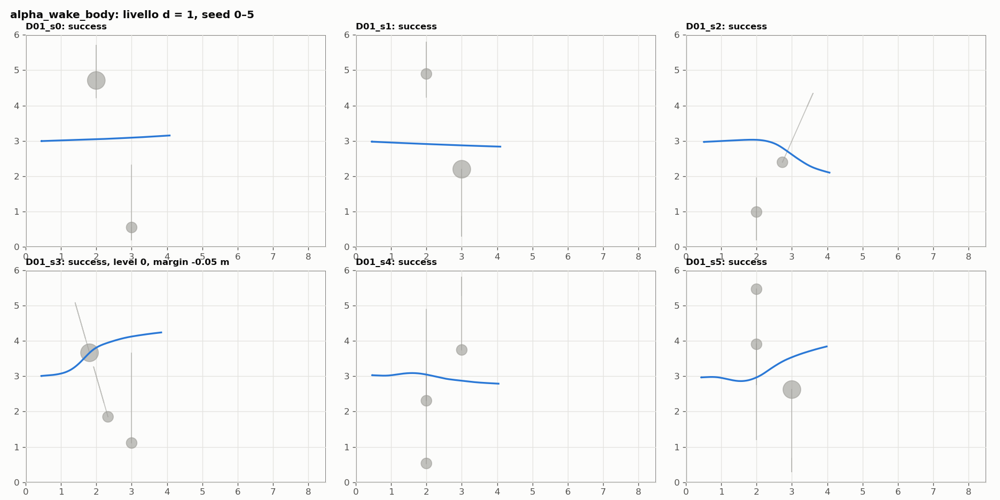

M1–M4, baseline contro α + scia (3 ripetizioni ciascuno; la freccia è il moto del cilindro):

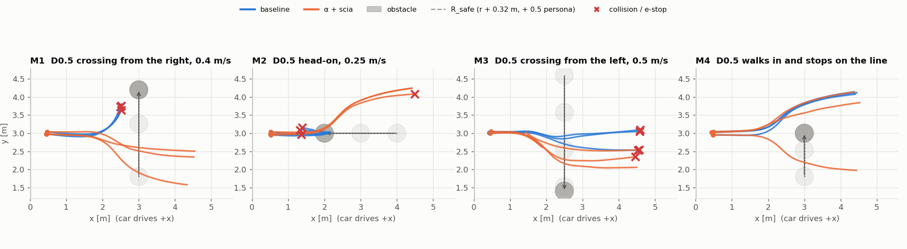

### Fase 2b: il ritorno

| | S1–S3: scarto finale medio (missione di 4 m) | rientrati < 0.10 m | overshoot max | S buoni |
|---|---|---|---|---|
| baseline (corridoio ri-ancorato sull'auto) | 1.23 m | 0/8 | 0 | 9/13 |
| linea fissa, solo `w_corr` di oggi | 0.34 m | 2/7 | **0.32 m** | 8/13 |
| arco di ritorno (α = 0) | 0.35 m | 2/8 | 0.00 | 9/13 |
| α + arco di ritorno | 0.59 m | 1/8 | 0.00 | 9/13 |

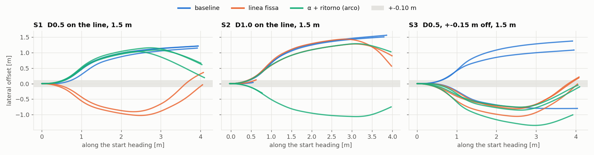

- **L'auto rientra.** Con la linea fissa lo scarto alla fine dei 4 m passa da ~1.2 m a 0.3–0.6 m. La missione di 4 m è però troppo corta per vederne il rientro completo (nel rig servono ~5 s, cioè 2.5 m dopo l'ostacolo).
- **La linea fissa senza arco oscilla**, come nel rig: 0.32 m di overshoot, attraversa la linea e torna. Con l'arco l'overshoot è zero.
- **Run buoni invariati** (S 9/13 come la baseline; M 8/12 con α + ritorno contro 7/12 con α solo). **Clearance:** il margine minimo su S1–S4 è −0.10 m contro −0.08 m della baseline, dentro la tolleranza dei 3 cm per run; il margine mediano sale da −0.01 a +0.06 m.
- **Non c'è stato tempo per misurare "α + scia + sonde + ritorno" insieme.** È la combinazione che il loop doveva esplorare per prima (§4).

## 4. Fase 3: loop di tuning

**Non è stato fatto in modo valido.** Il loop (`tuning/dodge_loop.py`: proponente `claude -p`, screening ×3 sui livelli d_fail−2…d_fail, conferma ×10, regressioni M/S con tolleranza di 1 run) è partito una volta alle 05:18 da "α + ritorno" e si è fermato dopo 5 iterazioni senza miglioramenti (`output/isaac_tuning/dodge/loop_20261118_0518/`):

| it | proposta | perché (sintesi del proponente) | d_fail prima → dopo | esito |
|---|---|---|---|---|
| 1 | `mpc_w_obs` 200 → 400, margine `unknown` 0 → 0.08 | lo sterzo non arrivava mai al limite: il costo ostacolo perdeva contro target e cross-track | 0 → 0 (d0 2/3) | rifiutato |
| 2 | `mpc_prediction_dt_s` 0.1 → 0.15, `mpc_obs_vel_lead_s` 0.2 | orizzonte 3 s invece di 2; compensare il ritardo dell'EMA del tracker | 0 → 0 (d0 1/3) | rifiutato |
| 3 | (casuale) dt 0.1025, orizzonte scia 1.0 | il proponente è andato in timeout | 0 → 0 (d0 2/3) | rifiutato |
| 4 | `mpc_w_term` 9 → 6, scia 150 | dare spazio al termine ostacolo, coprire l'incertezza della velocità | 0 → 0 (d0 0/3, 1 non valido) | rifiutato |
| 5 | (casuale) margine `unknown` 0.05 | timeout del proponente | 0 → 0 (d0 2/3) | rifiutato |

**Questo loop è girato con il filtro di velocità rotto** (§2.2), quindi le sue conclusioni non valgono. Dopo la correzione ho rifatto l'A/B, che ha preso il tempo, e ho preparato il loop per ripartire da "α + scia + sonde sul corpo" (d_fail 1, M e S misurati): proponente con timeout di 240 s, flag proponibili. La sessione si è però chiusa alle ~08:10, prima di lanciarlo. **Il loop resta da fare**; il comando è in §8.

Sul merito, le iterazioni rimangono istruttive. Il criterio della Fase 3 (3/3 buoni allo screening, poi 10/10 in conferma) con un tasso di successo per run di 50–80 % e il 3–5 % di run non validi rifiuta quasi qualunque candidato per caso. Come è scritto, a questi livelli il loop misura il rumore più che i parametri: servono più seed per livello, oppure un criterio sulla quota di buoni.

## 5. Parametri consigliati

`docs/mpc_dodge/mpc_params_tuned.yaml` contiene solo ciò che cambia rispetto a `stack_params.yaml`. Viene dall'A/B, non dal loop, che non è stato rifatto (§4). È "α + scia + sonde sul corpo", la variante migliore misurata su dodge, M e S insieme:

```yaml
semantic_track_velocity_enabled: true   # semantic_layer_node
mpc_obs_vel_trust: 1.0                  # mpc_corr
mpc_obs_wake_weight: 150.0
mpc_obs_body_probes: true
```

Il ritorno (`corridor_lateral_reanchor: false` + `mpc_return_*`) nel file è commentato. Con α ha funzionato senza perdere run buoni, ma insieme a scia e sonde non è stato misurato.

## 6. Fase 4: persone riconosciute dalla perception (fatta, a tempo limitato)

**Isaac** (`~/isaac_ws`, `mpc-tuning`, commit `74b07dd`). Ho portato l'idea di `people.py` dentro il meccanismo dei movers invece di un walker separato. `scene.obstacles` accetta `shape: person`: il personaggio `M_Medical_01` in posa `arms_down`, una capsula invisibile come collider (il LiDAR la vede), etichetta `person` (YOLO e il semantico GT la vedono come persona) e un `rotateZ` che la gira nel verso del moto. `/sim/scenario` la piazza e la parcheggia come un cilindro. Il moto `waypoints` `{points, speed, delay_s}` parte con `/sim/scenario_go`, e la ground truth esce su `/sim/ground_truth/movers` come per i cilindri. Il layout `people` è la stanza 6 × 6 di `tuning` con due persone parcheggiate. Limite: la persona scivola, senza ciclo di camminata.

**Scenari** P1–P4, con `unknown_objects_mode: off` come sull'auto (`fixed_node_params` dello scenario). `P<k>u` è lo stesso scenario con gli oggetti LiDAR attivi, per il confronto. R_safe di una persona = 0.29 + 0.20 + 0.12 + 0.5 (margine di classe) = 1.11 m. Parametri: "α + ritorno", il miglior set disponibile alle 06:00, 3 ripetizioni. Il filtro di velocità era ancora quello vecchio, che però tocca solo le tracce "unknown": le persone sono tracce riconosciute da YOLO.

| scenario | buoni (auto: unknown off) | buoni (unknown active) | rilevata in vista | rilevata dopo l'uscita dal campo visivo | errore di posizione |
|---|---|---|---|---|---|
| P1 attraversa da destra, 1 m/s | **3/3** | 2/3 | 48 % / 72 % | 0 % / 41 % | 0.35 / 0.28 m |
| P2 cammina verso l'auto, 0.5 m/s | 0/2 (+1 non valido) | 0/2 (+1 non valido) | 64 % / 90 % | 6 % / 25 % | 0.33 / 0.23 m |
| P3 entra e si ferma sulla linea | **3/3** | 3/3 | 96 % / 100 % | 2 % / 4 % | 0.28 / 0.23 m |
| P4 ferma sulla linea | **3/3** | 3/3 | 94 % / 99 % | 3 % / 2 % | 0.15 / 0.15 m |

(prima cifra: modalità dell'auto; seconda: unknown active; `output/isaac_tuning/dodge/phase4_people/`)

- **Cosa scende rispetto alla modalità unknown.** Con una persona **in moto** la catena YOLO → 3D → tracker la tiene nella lista ostacoli per meno tempo mentre è in vista: 48 % contro 72 % (P1) e 64 % contro 90 % (P2). L'errore di posizione è più alto (0.33–0.35 m contro 0.23–0.28 m: è il ritardo della detection). Quando esce dal campo visivo (101°) resta quasi sempre fuori dalla lista: 0–6 % contro 25–41 %. Sui run buoni la differenza non si vede (P1 3/3 contro 2/3; P3 e P4 uguali): il margine di classe di 0.5 m copre l'errore.
- **Latenza.** La "latenza" da ingresso in vista a prima detection è ~0, perché in tutti e quattro gli scenari la persona è già nel campo visivo alla partenza. Non ho avuto tempo per uno scenario che entri di lato dal fuori campo.
- **P2 (frontale)** fallisce in entrambe le modalità (−0.75 m). La persona continua a camminare verso l'auto e la raggiunge: è lo stesso caso di M2.
- **VRAM**: con Isaac, YOLO dello stack e la camera spettatore il picco è stato 3.67 GB sugli 8 GB, con `freeparty-llm` fermo.
- Le persone ferme (P3, P4) fanno scartare l'auto di ~2 m: è l'R_safe di 1.11 m.

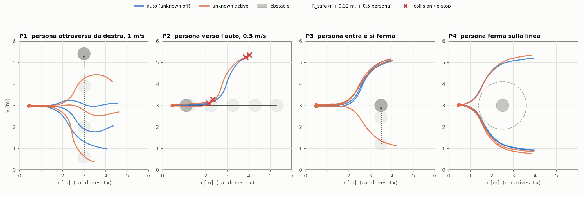

P1 (la persona attraversa da destra a 1 m/s) e P4 (ferma sulla linea) dalla camera spettatore:

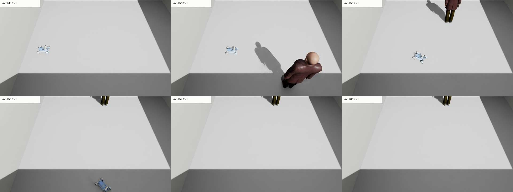

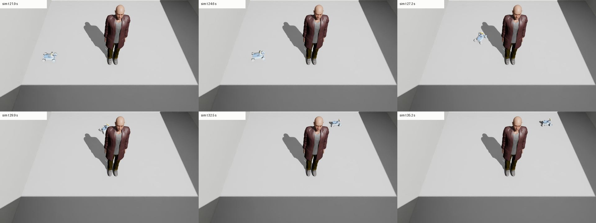

## 7. Cause dei fallimenti

Per ogni run dodge non buono, `scripts/sim/isaac_tuning/analysis/failure_modes.py` prende l'istante di minima clearance del corpo (il rettangolo dell'auto contro il cerchio del cilindro, ground truth). Lì guarda dove sta il cilindro rispetto all'auto, la velocità dell'auto, se il cilindro si muove verso il fianco e se lo stop LiDAR era già scattato.

Sui 42 run non buoni del primo A/B (tutti, di fatto, MPC statico):

| dove tocca / sfiora | esito | run | velocità dell'auto in quell'istante |
|---|---|---|---|
| davanti al muso | collisione (15), e-stop (1) | 16 | quasi tutti **ferma** (< 0.1 m/s), stop già scattato |
| fianco | collisione | 10 | ferma o lenta (0.0–0.16 m/s), stop scattato |
| coda / dietro il centro | sfioro (11), collisione (5) | 16 | **0.49 m/s**, in piena corsa |

In 38 casi su 42 il cilindro si sta muovendo verso il fianco dell'auto. Nell'A/B rifatto, la baseline ha 10 run non buoni (7 collisioni, 7 con lo stop scattato). "α + scia + sonde sul corpo" ne ha 4: 2 e-stop e 2 sfiori sul fianco sotto la tolleranza, **nessuna collisione**.

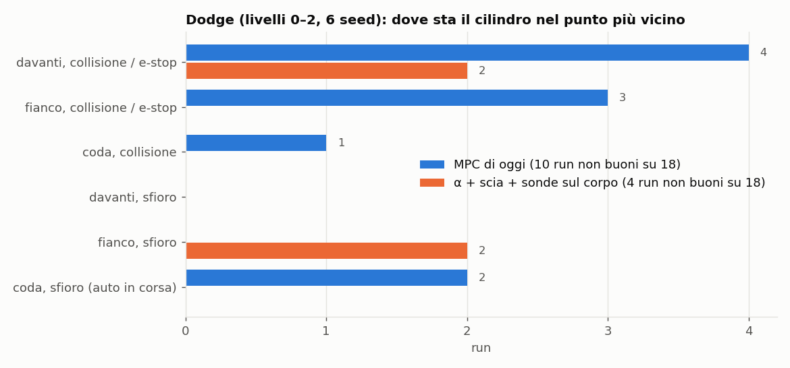

1. **Lo stop di sicurezza a 20 cm, poi il cilindro cinematico.** Il costo ostacolo tiene il centro asse a R_safe, ma gli spigoli del muso restano a ~0.07 m e scatta lo stop LiDAR (`IsProximityTooClose` / `hard_stop`). Da ferma, un cilindro che non reagisce le arriva addosso. È la causa di tutti gli M3 e S4 (e-stop in ogni variante, margine ≈ 0). Lo stop è un vincolo fisso, quindi la risposta sta nel margine (margine di classe `unknown`, `w_obs`, sonde sul corpo) o nel vedere prima (α, scia).
2. **Il costo ostacolo guarda solo davanti al muso.** Un cilindro che si chiude sulla coda o sul fianco di un'auto a 0.5 m/s non costa nulla una volta che il muso è passato: sono i 16 casi "in piena corsa". → `mpc_obs_body_probes`. Con le sonde i casi "coda in piena corsa" non compaiono più nell'A/B rifatto.
3. **La velocità non arrivava (primo A/B):** il filtro di elongazione la toglieva ai cilindri (§2.2). Corretto.
4. **Scarti larghi verso il livello successivo.** L'MPC statico scarta di 1–2 m nel verso in cui il cilindro va e finisce sulla traiettoria del livello dopo (`dodge_baseline_d00.png`). Con α lo scarto massimo mediano sui run dodge resta 0.3–0.4 m, ma la media scende da 0.81 a 0.46–0.50 m: gli scarti da 2 m spariscono quasi del tutto.
5. **La manovra di retromarcia.** In alcuni run l'auto ferma davanti ai cilindri fa scattare la retromarcia "stuck" (0.5 m), e retrocedere tra ostacoli che si muovono porta a contatti. È una funzione esistente dell'auto; nei dodge andrebbe valutato se disattivarla con ostacoli `v_valid` vicini.
6. **Rumore e infrastruttura.** Lo stesso set sullo stesso scenario cambia esito, perché l'istante del "go" e i tempi dello stack variano di qualche centinaio di ms (baseline d0: 2/3, poi 1/3). Nell'A/B rifatto il 2–20 % dei run di una variante è "non valido" (alpha: 4 su 30). Le cause: `/reset_all` rifiutato perché un reset scaduto era ancora in corso, auto ancora in movimento dopo un urto, servizi della missione non ancora su dopo un riavvio dello stack, liveness di `mpc_corr` mancata. Il recorder ora aspetta e ritenta (`cff8c5f2`, `820dfb10`, `a555e797`), ma l'ultima versione non è ancora passata da una serie completa. Dopo un contatto forte l'auto di Isaac può "esplodere" (|v| fino a 10⁷ m/s, poi NaN): le metriche ora si fermano lì (`4baf273d`). Una volta Isaac non è ripartito dopo un cambio di layout, perché il container vecchio non era ancora rimosso, e due varianti sono andate perse (corretto in `94f072b2`).
7. **Fuga laterale (rig).** Con un cilindro veloce che attraversa nello stesso verso in cui l'auto scarta, l'auto può continuare a scartare per metri (4 m nel rig senza pareti): il disco predetto resta "davanti". In Isaac lo limitano le pareti. Non l'ho visto risolto da nessuna variante.

## 8. Cosa resta aperto

1. **Rifare il loop della Fase 3** dalla variante consigliata, prima di tutto per provare il ritorno insieme a scia e sonde:
   ```bash
   cd ~/dev_ws/f1tenth_isaac_tuning
   systemctl --user stop freeparty-llm.service      # il loop lo rimette su alla fine
   printf 'mpc_obs_vel_trust: 1.0\nmpc_obs_wake_weight: 150.0\nmpc_obs_body_probes: true\n' > /tmp/start.yaml
   setsid nohup python3 scripts/sim/isaac_tuning/tuning/dodge_loop.py --start /tmp/start.yaml --d-fail 1 \
     --base-ab output/isaac_tuning/dodge/ab_phase2c/body/alpha_wake_body/summary.json --hours 8 \
     > output/isaac_tuning/dodge/loop.log 2>&1 < /dev/null &
   ```
   Prima conviene decidere il criterio (§4): con 3 seed e un tasso per run del 50–80 % il loop misura il rumore.
2. **d = 2 è un muro** (cilindri a 0.4 m/s): al massimo 3 run buoni su 6. Da guardare: il ritardo della velocità (l'EMA del tracker e i 0.5 s prima di `v_valid`), l'orizzonte di 2 s, la retromarcia "stuck" tra ostacoli che si muovono, la fuga laterale.
3. **M3 e S4: e-stop a margine ≈ 0.** Serve più margine laterale (sonde sul corpo, margine di classe `unknown`) o un R_safe che copra gli spigoli del muso, non solo il disco attorno al centro asse.
4. **M2 / P2 frontali:** con un ostacolo che viene dritto verso l'auto, collisione in tutte le varianti tranne qualche run (M2 2/3 con α). La velocità non dà preferenza di lato; la regola informata, in banda, arriva troppo tardi.
5. **Infrastruttura:** l'ultima versione del recorder (`a555e797`) non è ancora passata da una serie completa. Va verificato che il tasso di run non validi scenda sotto l'1 %.
6. **Bag:** con i campi nuovi di `Obstacle2D`, le bag vecchie con `/perception/obstacles_2d` vanno lette con un decoder legacy.
7. **Default di `corridor_lateral_reanchor`:** lasciato `true` (oggi), vedi §2.5.
8. **Persone:** manca uno scenario in cui la persona entri da fuori campo, per misurare davvero la latenza YOLO → tracker → MPC (§6).

## 9. Portare solo l'MPC sull'Orin

Il branch `mpc-dodge-mpc` contiene **solo lo stack**: MPC, semantic layer, messaggi e `stack_params.yaml`, niente harness né Isaac. Parte da `mpc-centerline-target-linus` (943f98c6), quindi include anche il target sulla centerline, `w_obs` 200 e la regola di lato del handoff. Sull'Orin (immagine Jazzy, ~10 minuti se cambiano solo i sorgenti; qui cambiano anche i messaggi, quindi si ricompila `f1tenth_messages` e chi ne dipende):

```bash
cd ~/dev_ws/f1tenth_car                         # pulito
git fetch origin mpc-dodge-mpc
git switch -c mpc-dodge-mpc FETCH_HEAD
ORIN_RUST=skip docker/orin/build.sh             # -> f1tenth:jazzy-orin-<sha>-norust
scripts/docker_orin.sh pin f1tenth:jazzy-orin-<sha>-norust && scripts/docker_orin.sh restart
```

- **L'immagine pinnata oggi è `33d7045` (`planners-on-car`).** Questo branch **non contiene i planner modes** (`planner_controller_mode`): va deciso se servono, e in quel caso va mergiato con quella linea prima del build.
- **Con i default, le novità sono tutte spente.** Rispetto a `mpc-centerline-target-linus` cambiano solo i messaggi: `Obstacle2D` e `SemanticObject` hanno campi in più. Tutto ciò che gira nell'immagine è compilato insieme, quindi va bene. Foxglove e gli strumenti di replay su linus vanno però ricompilati, e le bag vecchie con `/perception/obstacles_2d` non si decodificano più con il typesupport nuovo.
- **Per accendere quello che l'A/B in sim ha trovato utile**, cioè i valori di `docs/mpc_dodge/mpc_params_tuned.yaml`: sull'auto non c'è un overlay di parametri come in sim, quindi vanno cambiati i default in `src/f1tenth_params/config/stack_params.yaml`, in un commit sul branch di deploy. Serve sempre anche `semantic_track_velocity_enabled: true`.
- **Sull'auto `unknown_objects_mode` è `off`:** le velocità arrivano solo dalle tracce YOLO (persone, oggetti riconosciuti), non dal LiDAR.
- **Serve `mpc_solver_impl: py`** (è il default). Con `rust` il nodo scrive un errore e usa ostacoli statici: niente dischi predetti, niente scia, niente sonde sul corpo.

## 10. Dove sta tutto

- **`mpc-dodge-mpc`** (pushato), 6 commit su `943f98c6`: `5b962c0d` (velocità per traccia, dischi predetti, scia, regola informata, ritorno), `e512f728` e `33c4119b` (filtro di elongazione, poi corretto), `2476631e` (linea fissa anche sulle mosse drive), `19e3ec13` (Rust: ostacoli statici con errore nel log), `a4c3826e` (sonde sul corpo). Suite di `mpc_controller` (rieseguita sull'ultimo commit): gli stessi 35 fallimenti e 7 errori preesistenti di `943f98c6`, con 1618 test che passano contro 1598 (+20 nuovi); `f1tenth_costmap` 591/591 contro 582/582. Conteggi `ament_flake8`/`pep257` non peggiorati.
- **`isaac-mpc-tuning`** (pushato): harness (`dodge.py`, `ramp.py`, `evaluate.py`, `recompute.py`, `tuning/dodge_loop.py`, `analysis/`), merge di `mpc-dodge-mpc`, varianti in `tuning/variants_phase2*.yaml`, questo report, figure in `output/isaac_tuning/figures/`, run in `output/isaac_tuning/dodge/`.
- **Dati dei run nel repo:** `run.json`, `meta.json`, `instance.json`, i riassunti degli A/B (`ab.md`, `ab.json`, `summary.json`), lo stato del loop, i log del recorder e dello stack. **Restano solo su linus:** i CSV per run (ignorati per regola del repo, `*.csv` in `.gitignore`), i frame della camera spettatore (1669 jpg, 54 MB: nel repo ci sono i fogli di contatto) e i log di Isaac (32 file, 700 MB, alcuni oltre il limite di 100 MB di GitHub).
- **`~/isaac_ws` `mpc-tuning`** (pushato): `05341ed` (layout `dodge`, moto pingpong), `74b07dd` (persone mobili, waypoints, layout `people`).
- **Figure** (`output/isaac_tuning/figures/`): `rig_attraversamento.png`, `dodge_livelli_varianti.png`, `dodge_d01_baseline.png`, `dodge_d01_alpha_wake_body.png`, `dodge_baseline_d00.png`, `dodge_velocita_stimata.png`, `dodge_mappa_M_baseline_vs_alpha_scia.png`, `dodge_ritorno.png`, `dodge_modi_di_fallimento.png`, `persone_P1_P4.png`, `screen_dodge_D03_baseline.jpg`, `screen_P1_persona.jpg`, `screen_P4_persona.jpg`. Si rigenerano con `scripts/sim/isaac_tuning/analysis/report_figures.py`, `report_figures_extra.py` e `rig_figure.py` (quest'ultimo nell'ambiente dei test di `mpc_controller`); tabelle e diagnosi con `analysis/ab_table.py`, `analysis/failure_modes.py`, `analysis/velocity_quality.py`.
