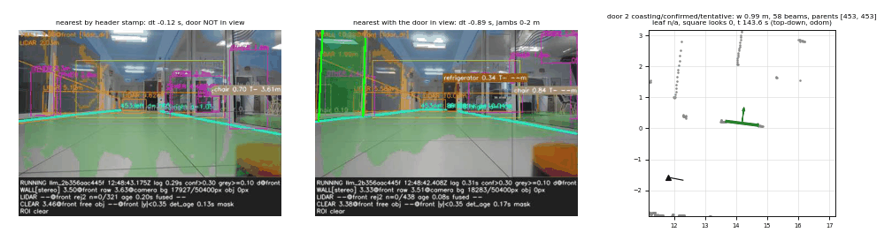
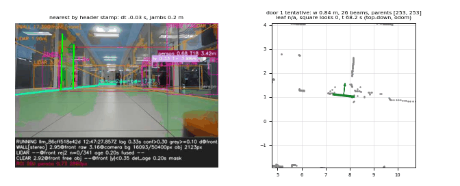
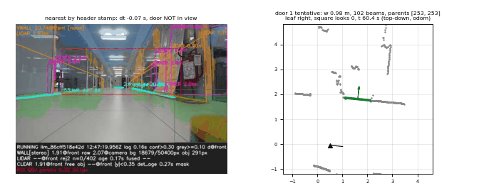
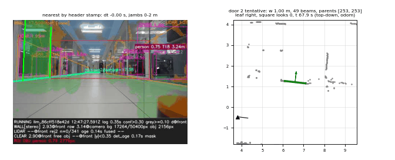
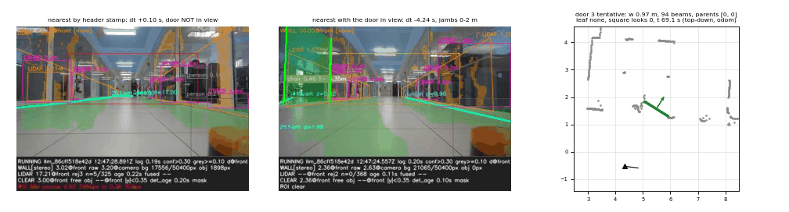
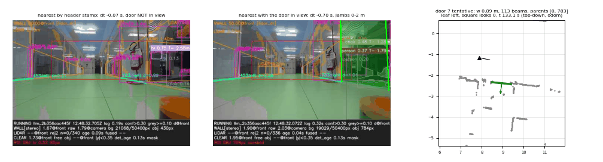
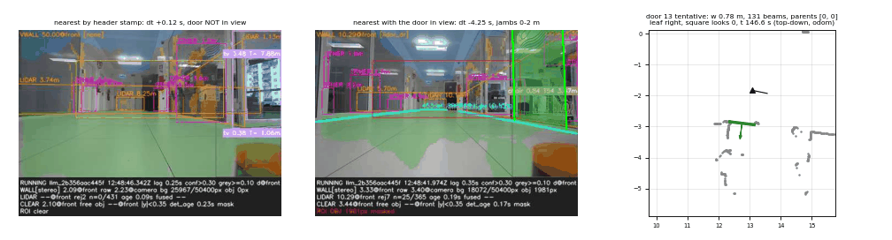

# Doors, phase 1: offline check on corridor10m_20261016T144537

Offline only: nothing here ran on the car, and nothing here was tuned on this
bag ("no code changes from it"). Two parts:

1. **Item 5** (this file, first part): door detection before and after the
   user's points 1-4 (step 2, `35e9c91`), and on this branch before the
   addendum.
2. **Addendum** (second part, added after the addendum commits): candidates by
   code before vs after the addendum.

## How it was run

`tools/door_replay.py` (`0ee22d9`): pure Python (rosbags + numpy, no rclpy,
nothing launched), the bag read in place from
`~/bags/corridor10m_20261016T144537/`.

- **Cadence**: the car's own tracker steps -- one door cycle per recorded
  `/perception/walls` message, on the `/scan` with the identical stamp:
  700 cycles (4 walls messages have no scan with their stamp).
- **Params**: each checkout's own `stack_params.yaml`, mapped exactly as
  `lidar_front_wall_node` maps them.
- **Pose**: `/odometry/filtered` interpolated at the scan stamp, the laser
  mount from `/tf_static`.
- **Not replayed**: the camera. No stereo support, no glass veto, no YOLO
  object sectors cut out of the scan, no persons (so no `object` rejects and
  no occupied doors).
- **Versions**: `before` = `8c5a355` (door detection v1, before points 1-4);
  `step2` = `98cb07e` (points 1-4 exactly); `p1` = `1148636` (this branch
  before the addendum: step 2 + step 3 -- frame jambs, seen square-on, pane
  memory -- + tonight's tracker fix `1b2155d`).
- **Walls**: `recorded` = the tracks the car published. They come from the
  tracker that ran on the car on 2026-10-16 (older than block 3 and than the
  collinear gap rule: extraction merge 1.5 m), and only the published ones
  (at most 4, by role). **Recorded walls cannot show point 1 (the merge
  rule)**; they isolate the DETECTOR's changes. `retrack-old` / `retrack-new`
  = the wall tracker re-run offline, LiDAR-only, with the pre-step-2 rule
  (merge 1.5 m, association 0.5 m) or the collinear gap rule (0.70 m). That
  is what shows point 1 -- but it is not the car's tracker either (no stereo
  walls, no rectangle verification, cold start), and on this bag it rebuilds
  none of the long through-glass tracks the recorded doors sit in.

Full outputs (per-cycle CSV, every judged gap, JSON, all door images):
`~/f1tenth_data/replays/doors_corridor10m_20261016T144537/phase1/<run>/`.

## Results

| run | cycles | door tracks | confirmed | codes (every judged gap) |
|---|---|---|---|---|
| before_8c5a355_recorded | 700 | 2 | 1 | width 497, shallow 35, not_collinear 24, on_line 21, accepted 7, jamb_occluded 6 |
| step2_98cb07e_recorded | 700 | 3 | 1 | width 491, not_collinear 24, shallow 17, accepted 7, on_line 7, jamb_occluded 5 |
| p1_1148636_recorded | 700 | 15 | 0 | width 1481, shallow 71, on_line 51, jamb_occluded 34, not_collinear 24, accepted 19, blocked 11, untracked_jamb 6, few_beams 4, not_a_leaf 1 |
| before_8c5a355_retrack-old | 700 | 0 | 0 | not_collinear 516, width 511, shallow 105, jamb_occluded 25, on_line 7, blocked 4, untracked_jamb 1 |
| step2_98cb07e_retrack-new | 700 | 0 | 0 | width 485, not_collinear 375, untracked_jamb 60, shallow 18, on_line 11, jamb_occluded 5 |
| p1_1148636_retrack-old | 700 | 14 | 0 | width 1585, not_collinear 714, shallow 209, jamb_occluded 101, on_line 81, untracked_jamb 21, accepted 16, blocked 6, few_beams 5, not_a_leaf 1 |
| p1_1148636_retrack-new | 700 | 14 | 0 | width 1546, not_collinear 585, shallow 150, untracked_jamb 99, on_line 83, jamb_occluded 83, accepted 15, blocked 7, few_beams 5, not_a_leaf 1 |

Door-step cost on linus (p50 / p95): before 0.99 / 1.18 ms, step2 0.98 /
1.22 ms, p1 7.6 / 9.3 ms (recorded walls) and 8.3-8.5 / 10.1-10.3 ms
(retrack) -- the difference is step 3's scan pieces and frame lines. Retrack
adds the offline tracker: 13-14 ms p50 a cycle.

### What it says

- **Points 1-4 on the car's own walls (before vs step2).** Both confirm the
  same single door, at odom (14.19, 0.16), 0.99-1.00 m wide, 40-50 beams
  across it -- a doorway INSIDE recorded track 453 (the in-track fallback:
  the car's 1.5 m extraction merge had joined both sides). Point 2 (the leaf,
  and ON past the line only 5 cm) changes where the pieces of wall end, so
  the gaps are cut differently: 551 judged instead of 590, `shallow` 35 -> 17,
  `on_line` 21 -> 7, still 7 positives. Step2 adds two tentative doors on the
  left wall at (1.62, 1.81) and (6.59, 1.21), both with a leaf on the right
  jamb, and sees the confirmed one with a right leaf in 4 of its 5 sightings.
- **Point 1 (the merge rule) with retrack.** With either rule, the v1 and
  step-2 detectors build no door at all on LiDAR-only tracks: the tracks the
  recorded doors sit in are long through-glass tracks the car's stereo-backed
  tracker built, which a LiDAR-only tracker does not. The rule shows only in
  the walls: on this branch, old vs new, eligible walls per cycle 6.03 vs
  5.97, track merges refused for the gap 429 vs 399, `not_collinear` 714 vs
  585 and `untracked_jamb` 21 vs 99 (gaps now lie between tracks, and their
  jambs must sit on a track's measured extent).
- **This branch before the addendum (p1).** 15 door tracks, **0 confirmed**:
  step 3's SEEN SQUARE-ON is never satisfied on this run (no door ever got a
  square look), two candidates were killed as panes, and step 3's frame
  jambs add 11 frame doors along the glass partitions -- the right-hand
  offices around x 8.9 and the left wall at x 13-16 -- all tentative. The
  door confirmed before step 3 appears again as doors 8, 9, 10 and 12, never
  confirmed. That is why tonight's addendum replaces the confirmation rule.

### Candidates by site

Door-sized gaps (0.5-1.3 m) clustered by their odom centre (0.3 m); the
"beams" column is the median number of beams crossing the gap, and
open / required is the decided / required beam count of the gaps that were
positive. Top 10 sites per run; the rest are in each run's
`*.candidates.csv`.

**before_8c5a355_recorded** -- door-sized gaps (0.5-1.3 m) by site (odom centre, 0.3 m):

| site (odom x, y) | gaps | codes | width med [m] | beams across the gap, med | open / required (positives) | doors |
|---|---|---|---|---|---|---|
| (6.48, 1.42) | 43 | width 41, shallow 2 | 1.058 | 9 | - / - | - |
| (16.74, -3.34) | 25 | shallow 23, width 1, on_line 1 | 0.733 | 42 | - / - | - |
| (9.26, 0.91) | 14 | width 7, on_line 6, shallow 1 | 0.995 | 58 | - / - | - |
| (15.83, -9.53) | 13 | not_collinear 13 | 0.593 | 0 | - / - | - |
| (14.19, 0.16) | 9 | accepted 6, width 3 | 0.997 | 48 | 48 / 43 | 2 (confirmed), 2 (tentative) |
| (7.79, 1.08) | 8 | on_line 4, width 2, shallow 1, accepted 1 | 0.836 | 88 | 26 / 21 | 1 (tentative) |
| (11.72, -2.65) | 7 | on_line 7 | 0.884 | 155 | - / - | - |
| (18.34, -0.35) | 6 | shallow 5, width 1 | 0.927 | 9 | - / - | - |
| (11.08, -9.16) | 5 | jamb_occluded 3, width 1, on_line 1 | 0.973 | 26 | - / - | - |
| (4.12, 1.65) | 4 | not_collinear 4 | 1.182 | 0 | - / - | - |
| ... 16 more sites, 32 gaps (candidates CSV) | | | | | | |

**step2_98cb07e_recorded** -- door-sized gaps (0.5-1.3 m) by site (odom centre, 0.3 m):

| site (odom x, y) | gaps | codes | width med [m] | beams across the gap, med | open / required (positives) | doors |
|---|---|---|---|---|---|---|
| (6.50, 1.41) | 24 | width 23, accepted 1 | 1.080 | 10 | 49 / 41 | 2 (tentative) |
| (21.62, -1.22) | 24 | width 11, shallow 10, on_line 3 | 0.929 | 9 | - / - | - |
| (15.83, -9.53) | 13 | not_collinear 13 | 0.593 | 0 | - / - | - |
| (16.68, -3.36) | 10 | shallow 7, on_line 2, width 1 | 0.783 | 44 | - / - | - |
| (14.19, 0.16) | 9 | accepted 5, width 4 | 0.998 | 50 | 50 / 42 | 3 (confirmed), 3 (tentative) |
| (9.65, 8.42) | 6 | width 4, jamb_occluded 2 | 0.956 | 21 | - / - | - |
| (11.08, -9.16) | 5 | jamb_occluded 3, width 1, on_line 1 | 0.973 | 26 | - / - | - |
| (4.12, 1.65) | 4 | not_collinear 4 | 1.182 | 0 | - / - | - |
| (11.50, 0.74) | 4 | not_collinear 4 | 0.703 | 0 | - / - | - |
| (-1.20, 2.06) | 3 | width 3 | 0.570 | 38 | - / - | - |
| ... 16 more sites, 21 gaps (candidates CSV) | | | | | | |

**p1_1148636_recorded** -- door-sized gaps (0.5-1.3 m) by site (odom centre, 0.3 m):

| site (odom x, y) | gaps | codes | width med [m] | beams across the gap, med | open / required (positives) | doors |
|---|---|---|---|---|---|---|
| (7.94, -2.26) | 54 | jamb_occluded 20, width 19, on_line 10, few_beams 3, blocked 2 | 0.722 | 19 | - / - | - |
| (1.91, -2.66) | 34 | width 24, on_line 10 | 1.029 | 31 | - / - | - |
| (16.70, -3.36) | 30 | shallow 29, width 1 | 0.768 | 44 | - / - | - |
| (6.51, 1.39) | 27 | width 26, accepted 1 | 1.075 | 10 | 49 / 41 | 2 (tentative) |
| (21.62, -1.22) | 24 | width 11, shallow 10, on_line 3 | 0.929 | 9 | - / - | - |
| (18.35, -0.34) | 21 | shallow 20, width 1 | 0.887 | 29 | - / - | - |
| (1.10, 2.92) | 19 | on_line 11, blocked 3, width 3, untracked_jamb 1, jamb_occluded 1 | 0.821 | 33 | - / - | - |
| (8.92, -2.36) | 16 | width 8, accepted 5, few_beams 1, not_a_leaf 1, on_line 1 | 1.034 | 17 | 62 / 53 | 4 (tentative), 5 (tentative), 6 (tentative), 7 (tentative) |
| (14.18, 0.16) | 15 | width 8, accepted 7 | 1.001 | 50 | 50 / 42 | 10 (tentative), 12 (tentative), 8 (tentative), 9 (tentative) |
| (15.83, -9.53) | 13 | not_collinear 13 | 0.593 | 0 | - / - | - |
| ... 57 more sites, 190 gaps (candidates CSV) | | | | | | |

**before_8c5a355_retrack-old** -- door-sized gaps (0.5-1.3 m) by site (odom centre, 0.3 m):

| site (odom x, y) | gaps | codes | width med [m] | beams across the gap, med | open / required (positives) | doors |
|---|---|---|---|---|---|---|
| (2.35, 2.19) | 292 | not_collinear 292 | 1.025 | 0 | - / - | - |
| (16.63, -3.33) | 84 | shallow 46, not_collinear 35, width 3 | 0.774 | 35 | - / - | - |
| (17.83, -0.28) | 69 | not_collinear 69 | 0.689 | 0 | - / - | - |
| (19.90, -0.53) | 48 | shallow 44, width 3, on_line 1 | 0.730 | 13 | - / - | - |
| (7.80, 1.11) | 27 | not_collinear 19, blocked 4, width 2, on_line 2 | 0.836 | 0 | - / - | - |
| (11.57, 0.78) | 25 | not_collinear 25 | 0.993 | 0 | - / - | - |
| (19.21, -0.35) | 24 | jamb_occluded 16, width 7, not_collinear 1 | 0.855 | 17 | - / - | - |
| (18.41, -0.34) | 22 | shallow 15, width 7 | 0.777 | 21 | - / - | - |
| (8.13, 2.10) | 16 | width 16 | 0.503 | 17 | - / - | - |
| (8.30, 1.20) | 12 | not_collinear 12 | 0.567 | 0 | - / - | - |
| ... 21 more sites, 69 gaps (candidates CSV) | | | | | | |

**step2_98cb07e_retrack-new** -- door-sized gaps (0.5-1.3 m) by site (odom centre, 0.3 m):

| site (odom x, y) | gaps | codes | width med [m] | beams across the gap, med | open / required (positives) | doors |
|---|---|---|---|---|---|---|
| (2.35, 2.19) | 292 | not_collinear 292 | 1.025 | 0 | - / - | - |
| (16.69, -3.35) | 79 | untracked_jamb 60, not_collinear 11, shallow 7, width 1 | 0.751 | 45 | - / - | - |
| (11.57, 0.78) | 25 | not_collinear 25 | 0.993 | 0 | - / - | - |
| (21.63, -1.20) | 24 | width 11, shallow 9, on_line 4 | 0.835 | 9 | - / - | - |
| (8.12, 2.10) | 15 | width 14, on_line 1 | 0.503 | 17 | - / - | - |
| (2.87, 2.07) | 8 | not_collinear 8 | 0.838 | 0 | - / - | - |
| (15.45, -9.65) | 8 | not_collinear 8 | 0.835 | 0 | - / - | - |
| (14.39, 4.89) | 7 | width 5, shallow 1, on_line 1 | 0.717 | 5 | - / - | - |
| (8.46, 8.53) | 6 | width 5, jamb_occluded 1 | 0.675 | 15 | - / - | - |
| (17.83, -0.31) | 6 | not_collinear 6 | 0.708 | 0 | - / - | - |
| ... 18 more sites, 40 gaps (candidates CSV) | | | | | | |

**p1_1148636_retrack-old** -- door-sized gaps (0.5-1.3 m) by site (odom centre, 0.3 m):

| site (odom x, y) | gaps | codes | width med [m] | beams across the gap, med | open / required (positives) | doors |
|---|---|---|---|---|---|---|
| (2.35, 2.19) | 292 | not_collinear 292 | 1.024 | 0 | - / - | - |
| (8.33, 1.26) | 273 | not_collinear 202, jamb_occluded 44, width 22, on_line 4, untracked_jamb 1 | 0.547 | 0 | - / - | - |
| (9.42, 0.97) | 103 | width 96, on_line 7 | 1.078 | 36 | - / - | - |
| (16.64, -3.35) | 94 | shallow 47, not_collinear 35, width 10, untracked_jamb 1, on_line 1 | 0.778 | 30 | - / - | - |
| (18.36, -0.34) | 83 | shallow 83 | 0.879 | 28 | - / - | - |
| (19.85, -0.53) | 79 | shallow 67, untracked_jamb 10, width 2 | 0.858 | 16 | - / - | - |
| (-0.01, 2.02) | 72 | width 50, on_line 16, jamb_occluded 5, accepted 1 | 0.692 | 74 | 75 / 61 | 1 (tentative) |
| (17.83, -0.28) | 69 | not_collinear 69 | 0.693 | 0 | - / - | - |
| (7.94, -2.26) | 60 | jamb_occluded 22, width 19, on_line 13, few_beams 4, blocked 2 | 0.725 | 19 | - / - | - |
| (1.91, -2.66) | 34 | width 24, on_line 10 | 1.029 | 31 | - / - | - |
| ... 71 more sites, 358 gaps (candidates CSV) | | | | | | |

**p1_1148636_retrack-new** -- door-sized gaps (0.5-1.3 m) by site (odom centre, 0.3 m):

| site (odom x, y) | gaps | codes | width med [m] | beams across the gap, med | open / required (positives) | doors |
|---|---|---|---|---|---|---|
| (2.35, 2.19) | 292 | not_collinear 292 | 1.024 | 0 | - / - | - |
| (8.33, 1.26) | 274 | not_collinear 205, jamb_occluded 42, width 21, on_line 5, untracked_jamb 1 | 0.548 | 0 | - / - | - |
| (9.41, 0.97) | 102 | width 96, on_line 6 | 1.078 | 36 | - / - | - |
| (16.71, -3.36) | 85 | untracked_jamb 50, shallow 18, not_collinear 11, width 5, on_line 1 | 0.751 | 45 | - / - | - |
| (18.37, -0.33) | 78 | shallow 78 | 0.797 | 28 | - / - | - |
| (19.86, -0.53) | 78 | untracked_jamb 40, shallow 38 | 0.854 | 16 | - / - | - |
| (-0.01, 2.02) | 72 | width 50, on_line 16, jamb_occluded 5, accepted 1 | 0.692 | 74 | 75 / 61 | 1 (tentative) |
| (7.94, -2.26) | 60 | jamb_occluded 22, width 19, on_line 13, few_beams 4, blocked 2 | 0.725 | 19 | - / - | - |
| (1.91, -2.66) | 34 | width 24, on_line 10 | 1.029 | 31 | - / - | - |
| (11.57, 0.77) | 26 | not_collinear 25, width 1 | 0.993 | 0 | - / - | - |
| ... 70 more sites, 299 gaps (candidates CSV) | | | | | | |

### Door images

Each image: the nearest `/camera/debug_image/compressed` frame by HEADER
stamp to the door's best sighting, the nearest frame with the door in view
(jamb posts 0-2 m projected through `/tf_static` and the camera_info), and
the top-down view (odom). For checking by eye.

| | |
|---|---|
| before, door 2 (confirmed, (14.19, 0.16)) |  |
| before, door 1 (tentative, (7.75, 1.06)) |  |
| step2, door 3 (confirmed, (14.19, 0.17), leaf right) |  |
| step2, door 1 (tentative, (1.62, 1.81), leaf right) |  |
| step2, door 2 (tentative, (6.59, 1.21), leaf right) |  |
| p1, door 9 (in-track, (14.18, 0.17), never square-on) |  |
| p1, door 10 (in-track, (14.20, 0.17)) |  |
| p1, door 3 (frame, (5.49, 1.57)) |  |
| p1, door 7 (frame, right-hand glass offices, (8.95, -2.37)) |  |
| p1, door 13 (frame, (12.75, -2.89)) |  |

Overviews (grey scan, dark eligible walls, blue frame pieces, green
confirmed / orange tentative doors):
[before](doors_phase1/before_8c5a355_recorded_overview.png),
[p1](doors_phase1/p1_1148636_recorded_overview.png).

### Limits of this check

- No camera: the stereo glass veto and stereo support never ran, and nothing
  was cut out for YOLO objects (the car cuts them).
- Recorded walls are the old tracker's; retrack is LiDAR-only. Neither is
  the car's tracker on this branch, so neither predicts exactly what the car
  will publish tomorrow.
- One bag, one corridor, one pass at 0.1-0.3 m/s. No ground-truth door list:
  the images are the check.

---

## Part 2: before vs after the addendum

Same tool, bag, cadence (700 tracker steps) and params source (each
checkout's `stack_params.yaml`). **Before** = `1148636` (this branch before the
addendum: step 3's frame jambs, square-on and panes on); **after** = `148d58e`
(the addendum's core, node and params). Also after with the optional
front-facing hosts on (`--set host_front_facing=True`). Full outputs:
`~/f1tenth_data/replays/doors_corridor10m_20261016T144537/addendum/`.

| run | door tracks | confirmed | door step p50 / p95 (linus) |
|---|---|---|---|
| before, recorded walls | 15 (11 on frame lines) | 0 | 7.6 / 9.3 ms |
| after, recorded walls | 0 | 0 | 1.05 / 1.9 ms |
| after, recorded + front-facing hosts | 0 | 0 | 1.1 / 2.0 ms |
| before, retrack-new | 14 (all frame) | 0 | 8.3 / 10.1 ms |
| after, retrack-new | 0 | 0 | 1.2 / 1.6 ms |
| after, retrack-new + front-facing hosts | 0 | 0 | 1.3 / 1.9 ms |

### Candidates by code

Every judged gap of the run, by its code. The old codes `shallow`, `blocked`
and `object` became `behind` and `unknown_in_gap` (with a detail); `accepted`
is now code `''` (a positive sighting).

| code (class after) | before, recorded | after, recorded | after, recorded + front-facing | before, retrack | after, retrack | after, retrack + front-facing |
|---|---:|---:|---:|---:|---:|---:|
| positive (`accepted` before, `''` after) | 19 | 0 | 0 | 15 | 0 | 0 |
| `not_a_leaf` (strong) | 1 | 1 | 1 | 1 | 0 | 0 |
| `not_boundary` (strong) | - | 3 | 3 | - | 0 | 0 |
| `on_line` (strong) | 51 | 0 | 0 | 83 | 0 | 0 |
| `shallow` -> `behind` (strong) | 71 | 0 | 0 | 150 | 0 | 0 |
| `short_line` (strong) | - | 3 | 3 | - | 2 | 4 |
| `short_side` (strong) | - | 9 | 9 | - | 1 | 1 |
| `blocked` -> `unknown_in_gap` (weak) | 11 | 0 | 0 | 7 | 0 | 0 |
| `few_beams` (weak) | 4 | 2 | 2 | 5 | 0 | 0 |
| `jamb_occluded` (weak) | 34 | 3 | 3 | 83 | 1 | 1 |
| `oblique_view` (weak) | - | 71 | 71 | - | 9 | 9 |
| `not_collinear` (geometry) | 24 | 13 | 13 | 585 | 0 | 0 |
| `untracked_jamb` (geometry) | 6 | 0 | 0 | 99 | 0 | 0 |
| `width` (geometry) | 1481 | 580 | 580 | 1546 | 198 | 229 |
| **all judged gaps** | 1702 | 685 | 685 | 2574 | 211 | 244 |

`-`: the code did not exist before the addendum.

Classes after the addendum, recorded walls: STRONG 16 rows (5 visible), WEAK
76 (1 visible), GEOMETRY 593; retrack: STRONG 3, WEAK 10, GEOMETRY 198 (none
visible). No positive sighting in any run, so no door track, no strike.

### What it says

- **The door the old cores confirmed, at odom (14.19, 0.16)**: 9 gaps there
  after the addendum -- `width` 4, `oblique_view` 3 (the car saw it at
  46-54° off its normal, beyond the 45° limit), `not_boundary` 2 (251-279
  returns behind the host segments: on this bag that recorded track runs
  through glass, so its "wall" either side of the gap is see-through).
- The other old candidates on the left wall, at (6.59, 1.21) and (1.62, 1.81):
  `width` (the gap between the hosts is wider than 1.00 m), `oblique_view`,
  one `not_a_leaf` and one `not_boundary` (48 hits).
- **Step 3's 11 frame doors are gone**: frame lines are unknown fragments and
  can never host a door (addendum A/B).
- On LiDAR-only retracked walls the long through-glass tracks do not exist, so
  the old in-track sites have no host pair at all; at (1.62, 1.81) the two
  confirmed hosts are 1.2-2.4 m apart (`width`).
- The Manhattan prior settles at 83.2° (the corridor's walls run at about -7°
  in odom), strength 1.0, from 2 (recorded) or 4 (retrack) confirmed walls of
  at least 1.5 m. No `off_manhattan` occurred.
- Front-facing hosts change nothing here (+2 `short_line` on retrack): the car
  never faced a doorway head-on in this run.
- Cost: the door step is 7x cheaper without step 3's scan pieces.

**Reading it for the car test**: in this glass-walled corridor the addendum's
conservative rules confirm nothing, and that is their intent (see-through hosts
fail `not_boundary`; doors only seen beyond 45° are undecidable). Doors in solid
side walls, seen within 45° of their normal from two positions 0.3 m apart, are
what it confirms (the synthetic tests F5, F9, the merge-rule 0.85 m case). This
bag has no camera image or depth stream, so `furniture`, `stereo_wall` and the
jamb height never ran offline (`jamb_height_unknown` throughout).
