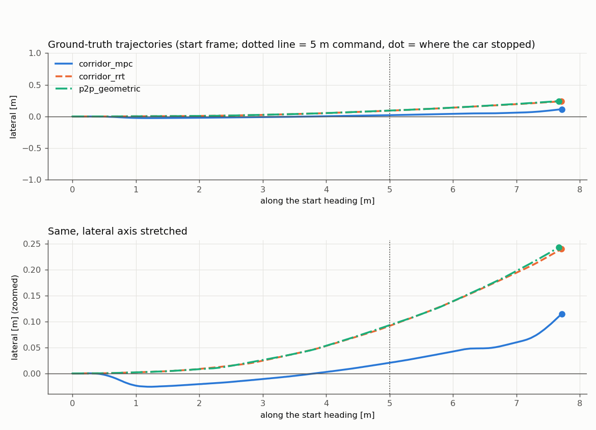
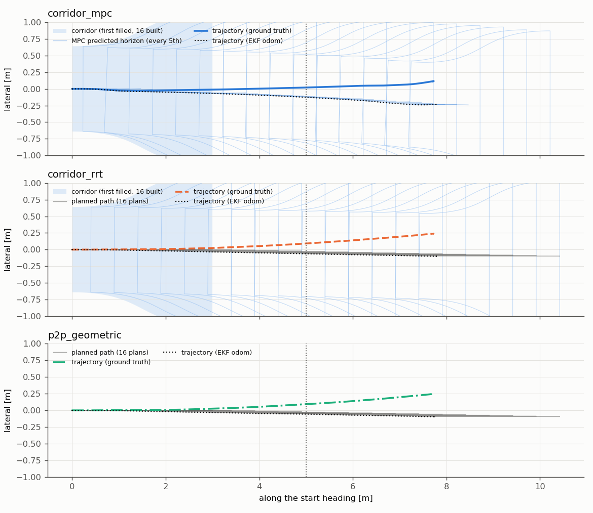
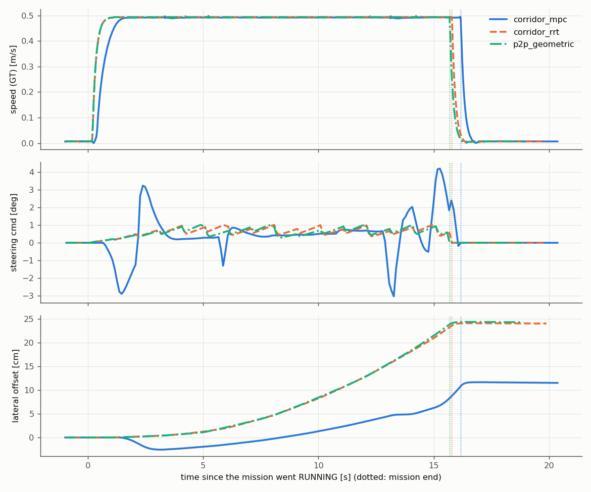
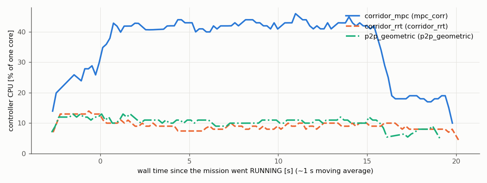

# Planner-controller comparison: "go straight 5m then enter the door on the left"

Session `door_sem2_20261113_152122`, host `DESKTOP-Q3F81S6`, scene `office` layout `door_left`, branch `planner-modes-hil` @ `e326bb4`. One run per mode, the same command sent through the LLM planner each time.

The LLM produced the **same mission** for every mode (moves sha `fa9e6540f521`):

```json
[
 {
  "id": "move_0_straight",
  "drive": {
   "mode": "straight",
   "speed": 0.5
  },
  "stop_condition": {
   "type": "distance_reached",
   "distance": 5.0
  },
  "timeout_sec": 35,
  "on_timeout": "abort"
 },
 {
  "id": "move_1_enter_door",
  "enter_door": {
   "type": "enter_door",
   "door": "left",
   "xy_tol": 0.15,
   "yaw_tol_deg": 10.0,
   "acquire_timeout_sec": 5.0,
   "approach_dist_m": 0.8
  },
  "stop_condition": {
   "type": "door_entered"
  },
  "timeout_sec": 65,
  "on_timeout": "abort",
  "terminal": true
 }
]
```

## Results

| metric | unit | corridor_mpc | corridor_rrt | p2p_geometric |
|---|---|---|---|---|
| mission result |  | ABORTED | ABORTED | ABORTED |
| mission duration | s | 16.17 | 15.78 | 15.68 |
| distance at mission COMPLETE | m | 7.656 | 7.652 | 7.602 |
| distance where the car stopped | m | 7.717 | 7.713 | 7.667 |
| stopped minus commanded | m | 2.717 | 2.713 | 2.667 |
| max lateral offset | m | 0.116 | 0.241 | 0.243 |
| RMS lateral offset (mission) | m | 0.033 | 0.1 | 0.1 |
| final heading error | deg | 6.61 | 4.1 | 4.13 |
| driven length | m | 7.748 | 7.746 | 7.692 |
| mean speed (mission) | m/s | 0.474 | 0.485 | 0.485 |
| max speed | m/s | 0.497 | 0.498 | 0.501 |
| mean |steering cmd| | deg | 0.91 | 0.62 | 0.6 |
| max |steering cmd| | deg | 4.2 | 1.01 | 1.01 |
| steering total variation | deg | 38.8 | 11.4 | 10.8 |
| reference tracked |  | corridor centreline | planned path | planned path |
| references published |  | 16 | 16 | 16 |
| max lateral of the reference | m | 0.277 | 0.097 | 0.094 |
| distance to reference, mean | m | 0.112 | 0.114 | 0.111 |
| distance to reference, max | m | 0.357 | 0.329 | 0.328 |
| EKF vs ground truth at the end | m | 0.354 | 0.347 | 0.347 |
| controller CPU, mission | % core | 42.2 | 8.7 | 10.6 |
| controller CPU, peak 1 s | % core | 45.9 | 11.0 | 13.0 |
| controller CPU, idle before | % core | 26.3 | 12.1 | 11.8 |
| controller CPU per sim second | ms | 412.5 | 89.6 | 103.2 |
| controller CPU per /drive msg | ms | 40.19 | 8.8 | 10.13 |
| /drive rate | Hz | 10.0 | 10.0 | 10.0 |
| replans (new modes) |  | - | 16 | 16 |
| plan time mean (wall) | ms | - | 1.05 | 0.34 |
| plan time p95 | ms | - | 1.16 | 0.36 |
| plan time max | ms | - | 1.4 | 0.37 |
| MPC solves |  | 160 | - | - |
| MPC solve success | % | 100.0 | - | - |
| MPC solve_dt mean (ROS clock) | ms | 0.0 | - | - |
| controller RSS | MB | 131.2 | 97.5 | 95.2 |
| sim real-time factor |  | 1.022 | 0.969 | 1.025 |
| host CPU busy (all cores) | % | 3.4 | 3.0 | 3.2 |
| LLM translation time | s | 21.219 | 20.159 | 20.971 |

Frame: the car's pose when the mission went RUNNING; x forward, y left. "stopped minus commanded" is ground truth against 5 m. CPU is the controller process from /proc (utime+stime, all threads) over the mission's wall-clock window; "per sim second" removes the sim's real-time factor.









## Notes

- **corridor_mpc**: mpc_corr solve_dt_sec is 0 throughout (ROS clock in sim time): use the process CPU columns for its cost
- **corridor_mpc**: mission ended ABORTED
- **corridor_rrt**: mission ended ABORTED
- **p2p_geometric**: mission ended ABORTED
