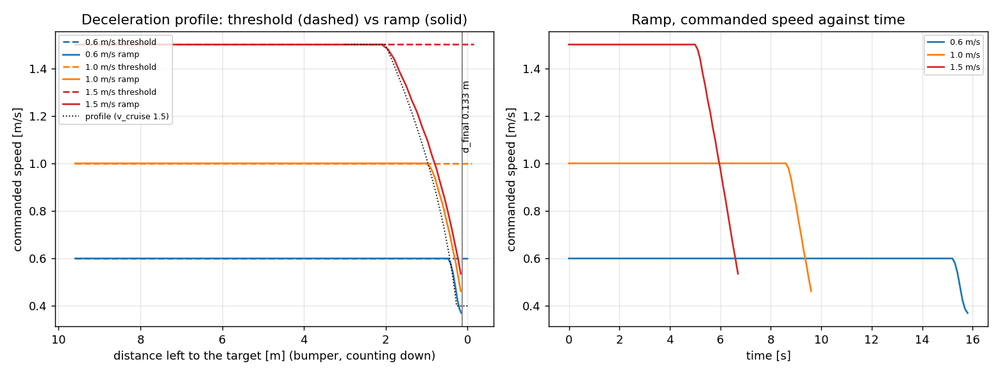

# Deceleration ramp -- nominal-model closed loop

mpc_controller/test/test_stop_ramp_closed_loop.py, the real solve_mpc_step around f1tenth_state_fcn_dt_beta, with the measured braking plant (tau 0.144 s, a 1.50 m/s^2) and a 0.2 s sensing delay. Target: 2.0 m from the wall at the front bumper. Negative stop error = too close to the wall.

| v_cruise | stop error, threshold | stop error, ramp | peak decel, ramp | approach s, threshold | approach s, ramp |
|---|---|---|---|---|---|
| 0.6 m/s | -0.331 m | +0.015 m | 0.59 m/s^2 | 16.2 s | 15.9 s |
| 1.0 m/s | -0.682 m | -0.025 m | 0.66 m/s^2 | 9.8 s | 9.7 s |
| 1.5 m/s | -1.271 m | -0.068 m | 0.66 m/s^2 | 6.6 s | 6.8 s |

d_final (hand-over) = 0.1333 m, computed from v_min 0.4, tau 0.2 s, a_stop 1.5 m/s^2.

